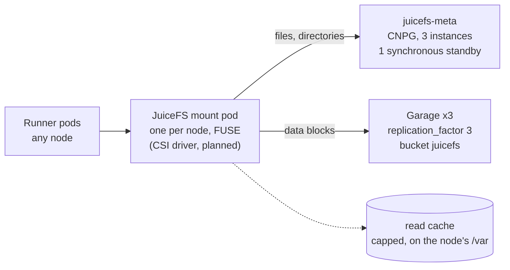

# JuiceFS (shared ReadWriteMany caches)

JuiceFS gives the ARC runners caches (`dnf-cache`, `cross-run-cache`, `container-shared-storage`) that every runner shares, whichever node it lands on. The LVM volumes are node-local and ReadWriteOnce, so they cannot do this. Image storage stays on local volumes: overlay on FUSE is a bad idea.

- Both backends run in `juicefs-system` (`k8s/apps/juicefs-system/`), on three different nodes. Garage stays off `talos-tba-msi`, which has no `vg-bulk`.
- One node lost: Garage keeps its quorum (2 of 3) and CNPG promotes a replica, so the caches stay readable and writable. Two nodes lost: Garage stops.
- There are no backups; the data is CI caches, and losing it costs a cold run.
- The sizes follow the peak use of the shared caches over 3 days (4.0 GiB in about 1.4k files): Garage 10 Gi data and 1 Gi metadata per node, 2 Gi per PostgreSQL instance.

## Growing a volume

`PersistentVolumeAlmostFull` fires first. CNPG grows when `storage.size` changes. Garage is a StatefulSet, and a new `persistence.*.size` changes its `volumeClaimTemplates`, which Kubernetes forbids and a Helm retry does not fix (`docs/helmrelease-conventions.md`): expand the three PVCs, then recreate the StatefulSet (`kubectl delete sts garage --cascade=orphan`) so Flux applies the new template.

## Monitoring

Garage and the CNPG pods carry `prometheus-scrape: "true"`, so the cluster-wide policy lets Prometheus in, and a ServiceMonitor and a PodMonitor register them. `prometheusrule.yaml` alerts on a missing Garage node (`JuiceFSGarageDegraded`), lost quorum (`JuiceFSGarageUnavailable`), a missing PostgreSQL instance (`JuiceFSMetaInstanceMissing`) and replication lag (`JuiceFSMetaReplicationLag`).
