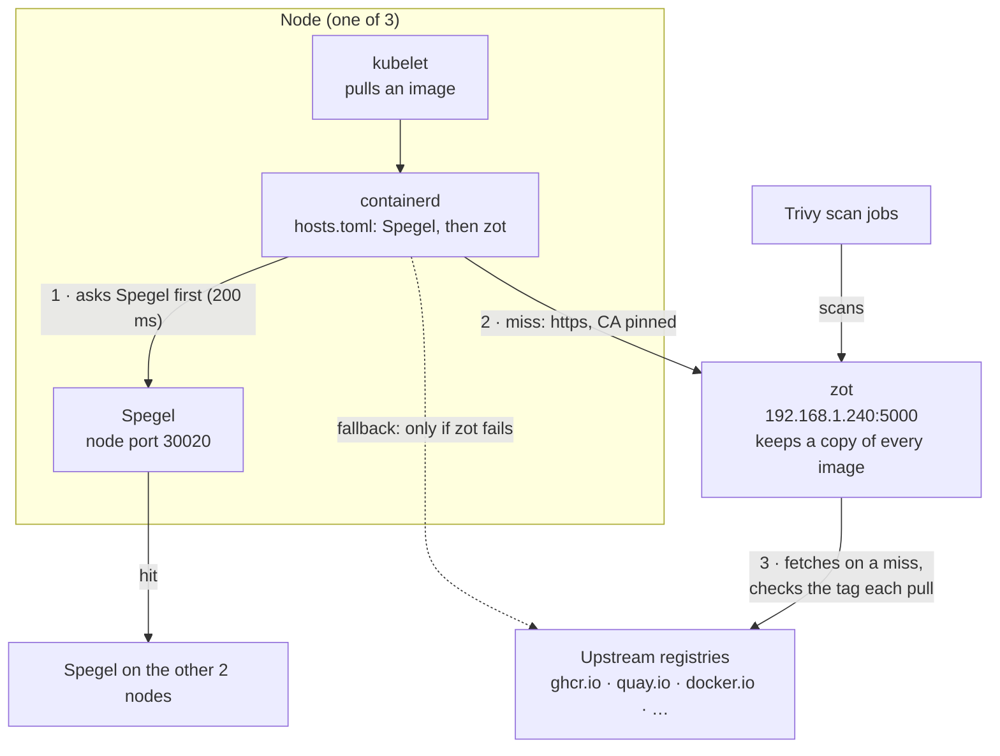

# Registry mirrors on the nodes

Image pulls on a node go containerd, then Spegel, then zot, then the upstream registry:



After a Talos registry patch and until the Spegel pods restart, containerd skips Spegel and goes to zot directly (step 1 is missing).

- containerd reads `/etc/cri/conf.d/hosts/<registry>/hosts.toml`. Talos writes these files from `patches/11-zot-mirrors.yaml`
  (seven registries, each pointing at its zot cache over https, with the root CA pinned). Spegel's init container
  (`k8s/infra/registry-system/spegel/`) saves them to `_backup` once and rewrites each file as Spegel first, then the saved hosts.
- Spegel answers from the other nodes. A miss moves on to zot (`192.168.1.240:5000`), which fetches from the internet when it
  has to and keeps a copy. Containerd goes straight to the upstream registry only when zot fails.
- The certificate zot serves comes from `certificate-cluster-issuer` and lists `192.168.1.240`. The CA certificate in the patch
  is the public part of `portableinfo-root-ca` (valid until 2036-11-07). The patch holds a copy, so a re-issued CA needs the patch updated.

## After changing a Talos registry patch

Talos rewrites the seven files on every change of its registry or CRI configuration (also at boot) and deletes everything else
in that directory, including Spegel's `_backup`. Spegel then drops out of the chain until its init container runs again:

1. Apply the patch to the nodes.
2. Restart Spegel: `kubectl -n registry-system rollout restart ds/spegel` (one pod at a time). The PodSecurity warning it prints is only a
   warning: Spegel needs hostPath volumes and root.
3. Check the init log of each new pod: `kubectl -n registry-system logs spegel-<id> -c configuration` shows
   `backing up containerd host configuration` and `prepending to existing containerd mirror configuration` for the seven registries.

## Checking that pulls take the whole path

- zot: `zot_repo_downloads_total` rises for a `ghcr-cache/…` repository that only kubelet pulls, for example
  `ghcr-cache/cthtrifork/talos-gitops/vex-cache`.
- Spegel: `spegel_mirror_requests_total` rises for the same registry (hit or miss). Without Spegel in the chain only the zot counter moves.
- A pull that skips zot shows no zot download and the image still arrives from the internet, so a failure here does not break pulls.
- Spegel's mirror is a NodePort, so a pull on one node can be counted on any Spegel pod. Compare the sum over the pods with the
  pulls of the node you are testing, and look at the scan pods' `nodeName` to know which node that is.

## Testing a miss on every node

Run a pod that pulls an image no node has. Use a different tag per node, because a node that already
pulled a tag lets Spegel answer the others from it (a hit, which does not reach zot):

```sh
kubectl run pull-test  --restart=Never --image=mirror.gcr.io/library/busybox:1.36.1 --overrides='{"spec":{"nodeName":"talos-11a-esj"}}' -- true
kubectl run pull-test2 --restart=Never --image=mirror.gcr.io/library/busybox:1.36.0 --overrides='{"spec":{"nodeName":"talos-tba-msi"}}' -- true
kubectl run pull-test3 --restart=Never --image=mirror.gcr.io/library/busybox:1.35.0 --overrides='{"spec":{"nodeName":"talos-11a-esj"}}' -- true
```

The pods run in the namespace you are in (`kubectl -n default get pod pull-test`); delete them afterwards. What a working chain shows:

- the pod's `Pulled` event within a few seconds, with no `ErrImagePull`;
- zot's log (`kubectl -n registry-system logs zot-0`) has `Copy layer`, `pushing synced local image to local registry` and
  `successfully synced image` for `docker-hub-cache/library/busybox`, then the tag;
- `spegel_mirror_requests_total{registry="mirror.gcr.io",cache="miss"}` rises. The series only exists after its first request, so a
  query that compares the first and last value of a window misses it; read the current value.

`zot_repo_downloads_total` is not a reliable signal for these pulls: it does not move for them, although the log shows the sync, and it
also counts zot's own sync activity. To see who reads a repository, count the requests for it in zot's log (`HTTP API` lines carry
`path` and `clientIP`) or use `zot_http_repo_latency_seconds_count{repo=...}`.

## Checking each node

Patch 11 is applied per node. The init log of a new Spegel pod shows what its node had when the pod started:
`kubectl -n registry-system logs spegel-<id> -c configuration`.

- A node with the patch logs `backing up containerd host configuration` for the seven registries and for `192.168.1.240_5000_`
  (the TLS directory), then `prepending to existing containerd mirror configuration` seven times.
- A node without those backup lines had no Talos files when Spegel last started, or kept an older saved copy. Its pulls skip zot
  and go from Spegel to the upstream registry. Apply the patch to that node and restart its Spegel pod.
- A pull test only proves the node that pulled. The scan pods run on one node, so they say nothing about the others.

## Zot settings behind this path

`k8s/infra/registry-system/zot/zot.json`:

- one sync entry per registry, each `onDemand` with `tlsVerify`, `maxRetries: 1` and `retryDelay: 5s`, so an unreachable upstream
  fails in seconds and zot serves the copy it has. Repository names are the cache name plus the image path, for example
  `ghcr-cache/cthtrifork/talos-gitops/vex-cache`. `docker-hub-cache` serves both `docker.io` and `mirror.gcr.io`, and `ghcr-cache`
  reaches private `cthtrifork` packages with the credentials in `creds.json`.
- there is no polled sync and no `ghcr-private` mirror: the nodes and the CI reach `cthtrifork` images through `ghcr-cache`. The
  retention policy for `ghcr-private/**` matches no tag, so anything under that prefix expires; delete the policy when no such
  repository is left. A polled sync would copy every tag of a repository again after retention removed it, so retention could not
  keep its size down.
- retention keeps the newest tag of every cache repository and, with `keepUntagged`, the newest and the most recently pulled untagged
  manifest, so digest-pinned images stay available without internet. Tagged and untagged manifests of the caches and the catch-all policy are also kept 720 hours after their last pull or push. `pr/**` and `buildcache/**` keep 72 hours.
- the zot volume is 150Gi on `lvm-fast`, a real volume of that size (expandable online); a PVC's storage class cannot change in place, so moving it means recreating the StatefulSet and the PVC (the cache refills on demand).

## OCIRepositories (Flux charts)

source-controller has no containerd, so its OCIRepositories cannot fall back to the upstream registry: in the cluster their `spec.url` names zot itself,
`oci://zot.registry-system.svc.cluster.local:5000/<cache>/<upstream path>` (`ghcr-cache` for ghcr.io, `quay-cache` for quay.io; the same
cache names as `patches/11-zot-mirrors.yaml`). A zot outage therefore stalls chart reconciliation, and the digest pin in `spec.ref` stays valid
because zot keeps the upstream manifests unchanged.

The file holds the upstream address behind a Flux variable with the registry as its default:
`url: oci://${ZOT_MIRROR_GHCR:=ghcr.io}/traefik/helm/traefik` (`ZOT_MIRROR_QUAY` for quay.io). The cluster sets the variables, so Flux pulls
through zot; everything that reads the file without them (CI, Renovate, `render-manifests.sh`) sees the upstream registry.

- Where the variables are set: one patch in `k8s/clusters/homelab/kustomization.yaml` adds `ZOT_MIRROR_GHCR` and `ZOT_MIRROR_QUAY` to the
  `postBuild.substitute` of the Flux Kustomizations listed in its `name` pattern. A Kustomization that gets a new OCIRepository must be added
  there; if its name is missing the chart is silently pulled from upstream. A new upstream registry needs a variable of its own, set there.
- Not routed through zot (no variable): the charts zot depends on, which would deadlock a cluster rebuilt from empty: Cilium, flux-operator,
  cert-manager, trust-manager, openebs-lvm (zot's volume), Spegel, zot itself and prometheus-operator-crds (bootstrap). They keep their upstream URL.
- Charts without an upstream OCI chart (polaris, metrics-server, Redpanda `connect`) are mirrored to
  `ghcr.io/cthtrifork/talos-gitops/charts` by `.github/workflows/helm-chart-sync.yaml` (configs in `scripts/ci/helm/`) and read from there
  through `ghcr-cache`. A new chart version appears in Git only after the sync has pushed it.
- TLS: the FluxInstance patch in `k8s/clusters/homelab/flux-instance.yaml` mounts the trust-manager ConfigMap `portableinfo-ca-bundle` into
  source-controller (`SSL_CERT_DIR`). The volume is optional so source-controller still starts before trust-manager exists.
- Network policy: `flux-system-egress-zot` (`k8s/infra/flux-system/`) and the `zot` policy in `k8s/infra/registry-system/networkpolicy.yaml`.
- Renovate: `registryAliases` in `renovate.json5` maps each literal default (`${ZOT_MIRROR_GHCR:=ghcr.io}`) to its registry, so the flux
  manager looks versions up upstream. A new variable needs an alias there.
- Rendering: `scripts/ci/render-manifests.sh` runs `flux envsubst` over `helm-repository.yaml`, so it renders from the default (upstream)
  registry, and through zot wherever `ZOT_MIRROR_*` is set in its environment (a runner in the cluster). A `localhost` registry is
  pulled over plain HTTP. To try that on a workstation, `make render-manifests-zot` starts `scripts/zot/compose.yaml` (a local zot
  with the cluster's caches: same cache names, on-demand sync from the upstream registries, no TLS, credentials or retention) and renders
  through it with `ZOT_MIRROR_GHCR=localhost:5000/ghcr-cache` and `ZOT_MIRROR_QUAY=localhost:5000/quay-cache`; `RENDER_DIRS="dir1 dir2"`
  limits it. It leaves zot running (`make zot-down` stops it; `docker compose -f scripts/zot/compose.yaml down -v` also empties the
  cache). The first render fills the cache from upstream, later ones read it. The charts of the bootstrap chain and external-dns have no
  variable, so they are always pulled from upstream.
- e2e: kind's CoreDNS gets a `hosts` entry for the zot service name and `portableinfo-ca-bundle` is created from the runner's CA
  (steps "Resolve the cluster zot inside kind" and "Trust the private CA in flux-system" in `.github/workflows/e2e.yaml`).

## Using Spegel alone

Set the Spegel values to `mirroredRegistries: []` and `prependExisting: false`, then restart the Spegel pods. Spegel then writes one
`_default` mirror and zot serves Trivy only.
