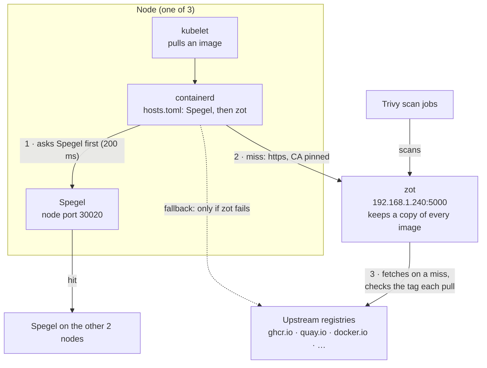

# Registry mirrors (nodes and Flux charts)

Image pulls on a node go containerd, then Spegel, then zot, then the upstream registry:



After a Talos registry patch and until the Spegel pods restart, containerd skips Spegel and goes to zot directly (step 1 is missing).

- containerd reads `/etc/cri/conf.d/hosts/<registry>/hosts.toml`. Talos writes these files from `patches/11-zot-mirrors.yaml`
  (seven registries, each pointing at its zot cache over https, with the root CA pinned). Spegel's init container
  (`k8s/infra/registry-system/spegel/`) saves them to `_backup` once and rewrites each file as Spegel first, then the saved hosts.
- Spegel answers from the other nodes. A miss moves on to zot (`192.168.1.240:5000`), which fetches from the internet when it
  has to and keeps a copy. Containerd goes straight to the upstream registry only when zot fails.
- The certificate zot serves comes from `certificate-cluster-issuer` and lists `192.168.1.240`. The CA certificate in the patch
  is the public part of `portableinfo-root-ca` (valid until 2036-11-07). The patch holds a copy, so a re-issued CA needs the patch updated.

## After changing a Talos registry patch

Talos rewrites the seven files on every change of its registry or CRI configuration (also at boot) and deletes everything else
in that directory, including Spegel's `_backup`. Spegel then drops out of the chain until its init container runs again:

1. Apply the patch to the nodes.
2. Restart Spegel: `kubectl -n registry-system rollout restart ds/spegel` (one pod at a time). The PodSecurity warning it prints is only a
   warning: Spegel needs hostPath volumes and root.
3. Check the init log of each new pod: `kubectl -n registry-system logs spegel-<id> -c configuration` shows
   `backing up containerd host configuration` and `prepending to existing containerd mirror configuration` for the seven registries.

## Checking that pulls take the whole path

- zot: `zot_repo_downloads_total` rises for a `ghcr-cache/…` repository that only kubelet pulls, for example
  `ghcr-cache/cthtrifork/talos-gitops/vex-cache`.
- Spegel: `spegel_mirror_requests_total` rises for the same registry (hit or miss). Without Spegel in the chain only the zot counter moves.
- A pull that skips zot shows no zot download and the image still arrives from the internet, so a failure here does not break pulls.
- Spegel's mirror is a NodePort, so a pull on one node can be counted on any Spegel pod. Compare the sum over the pods with the
  pulls of the node you are testing, and look at the scan pods' `nodeName` to know which node that is.

## Testing a miss on every node

Run a pod that pulls an image no node has. Use a different tag per node, because a node that already
pulled a tag lets Spegel answer the others from it (a hit, which does not reach zot):

```sh
kubectl run pull-test  --restart=Never --image=mirror.gcr.io/library/busybox:1.36.1 --overrides='{"spec":{"nodeName":"talos-11a-esj"}}' -- true
kubectl run pull-test2 --restart=Never --image=mirror.gcr.io/library/busybox:1.36.0 --overrides='{"spec":{"nodeName":"talos-tba-msi"}}' -- true
kubectl run pull-test3 --restart=Never --image=mirror.gcr.io/library/busybox:1.35.0 --overrides='{"spec":{"nodeName":"talos-11a-esj"}}' -- true
```

The pods run in the namespace you are in (`kubectl -n default get pod pull-test`); delete them afterwards. What a working chain shows:

- the pod's `Pulled` event within a few seconds, with no `ErrImagePull`;
- zot's log (`kubectl -n registry-system logs zot-0`) has `Copy layer`, `pushing synced local image to local registry` and
  `successfully synced image` for `docker-hub-cache/library/busybox`, then the tag;
- `spegel_mirror_requests_total{registry="mirror.gcr.io",cache="miss"}` rises. The series only exists after its first request, so a
  query that compares the first and last value of a window misses it; read the current value.

`zot_repo_downloads_total` is not a reliable signal for these pulls: it does not move for them, although the log shows the sync, and it
also counts zot's own sync activity. To see who reads a repository, count the requests for it in zot's log (`HTTP API` lines carry
`path` and `clientIP`) or use `zot_http_repo_latency_seconds_count{repo=...}`.

## Checking each node

Patch 11 is applied per node. The init log of a new Spegel pod shows what its node had when the pod started:
`kubectl -n registry-system logs spegel-<id> -c configuration`.

- A node with the patch logs `backing up containerd host configuration` for the seven registries and for `192.168.1.240_5000_`
  (the TLS directory), then `prepending to existing containerd mirror configuration` seven times.
- A node without those backup lines had no Talos files when Spegel last started, or kept an older saved copy. Its pulls skip zot
  and go from Spegel to the upstream registry. Apply the patch to that node and restart its Spegel pod.
- A pull test only proves the node that pulled. The scan pods run on one node, so they say nothing about the others.

## Zot settings behind this path

`k8s/infra/registry-system/zot/zot.json`:

- One sync entry per registry, each `onDemand` with `tlsVerify`, `maxRetries: 1` and `retryDelay: 5s`, so an unreachable upstream fails in
  seconds and zot serves its copy. Repositories are the cache name plus the image path (`ghcr-cache/cthtrifork/talos-gitops/vex-cache`).
  `docker-hub-cache` serves both `docker.io` and `mirror.gcr.io`; `ghcr-cache` reaches private `cthtrifork` packages with the credentials in
  `creds.json`.
- No polled sync and no `ghcr-private` mirror: nodes and CI use `ghcr-cache`. A polled sync would copy every tag again after retention removed
  it. The `ghcr-private/**` retention policy matches no tag, so that prefix expires; delete the policy when no such repository is left.
- Retention keeps the newest tag of every cache repository and, with `keepUntagged`, the newest and most recently pulled untagged manifest,
  so digest-pinned images stay available without internet. The caches and the catch-all policy also keep anything pulled or pushed within
  720 hours; `pr/**` and `buildcache/**` keep 72.
- The volume is 150Gi on `lvm-fast` (expandable online). A PVC's storage class cannot change in place: moving it means recreating the
  StatefulSet and the PVC, and the cache refills on demand.

## OCIRepositories (Flux charts)

source-controller has no containerd, so it cannot fall back to the upstream registry the way the nodes do. Every OCIRepository therefore
reads its chart through zot's caches (`ghcr-cache`, `quay-cache`, `k8s-cache`, the names of `patches/11-zot-mirrors.yaml`):

```yaml
url: oci://${ZOT_MIRROR_GHCR:=ghcr.io}/traefik/helm/traefik   # ZOT_MIRROR_QUAY for quay.io, ZOT_MIRROR_K8S for registry.k8s.io
```

The variable defaults to the upstream registry, so everything that reads the file without it (CI, Renovate, `render-manifests.sh`) uses
upstream. The cluster sets it, so Flux pulls through zot. The digest pin in `spec.ref` stays valid because zot keeps upstream manifests
unchanged.

- **Variables:** `k8s/clusters/homelab/cluster-vars.env`, turned into the ConfigMap `cluster-vars` by the cluster kustomization. One patch
  there makes every Flux Kustomization substitute from it (optional), so a new OCIRepository needs no wiring. A new upstream registry needs a
  variable of its own in that file and an alias in `renovate.json5`.
- **Without zot:** zot, Cilium and cert-manager come from OCIRepositories too, so a cluster rebuilt from empty cannot pull them from a zot that
  does not exist yet. Comment the variables out in `cluster-vars.env` for the first sync, wait until `gitops-infra-registry-system` is Ready,
  then restore them (the same gets you past a zot that cannot start). The controllers' world-egress policy keeps ghcr.io and quay.io for that
  case. On a running cluster a zot outage only holds back new chart versions, because source-controller keeps the artifacts it fetched.
- **Mirrored charts:** polaris, metrics-server and Redpanda `connect` have no upstream OCI chart.
  `.github/workflows/helm-chart-sync.yaml` (configs in `scripts/ci/helm/`) copies them to `ghcr.io/cthtrifork/talos-gitops/charts`, and they are
  read from there through `ghcr-cache`. A new version appears in Git only after the sync has pushed it.
- **TLS:** the FluxInstance patch in `k8s/clusters/homelab/flux-instance.yaml` mounts the trust-manager ConfigMap `portableinfo-ca-bundle` into
  source-controller (`SSL_CERT_DIR`). The volume is optional, so source-controller starts before trust-manager exists. This is the one place
  that does not use the Kyverno injection (`docs/security.md`, "Trust bundle injection"): `flux-system` is excluded so Flux does not depend on
  Kyverno or on a ConfigMap that trust-manager creates from an OCIRepository Flux itself has to pull.
- **Network policy:** `flux-system-egress-zot` (`k8s/infra/flux-system/`) and the `zot` policy in `k8s/infra/registry-system/networkpolicy.yaml`.
- **Renovate:** `registryAliases` maps each literal default (`${ZOT_MIRROR_GHCR:=ghcr.io}`) to its registry, so versions are looked up upstream.
- **Rendering:** `scripts/ci/render-manifests.sh` runs `flux envsubst` over `helm-repository.yaml`: upstream by default, through zot where
  `ZOT_MIRROR_*` is set (a localhost registry over plain HTTP). `make render-manifests-zot` does that on a workstation with the local zot of
  `scripts/zot/compose.yaml` (same cache names, on-demand sync, no TLS, credentials or retention) and leaves it running; `make zot-down`
  stops it, `docker compose -f scripts/zot/compose.yaml down -v` also empties the cache. `RENDER_DIRS="dir1 dir2"` limits the render.
- **e2e:** kind's CoreDNS gets a `hosts` entry for the zot service name and `portableinfo-ca-bundle` is created from the runner's CA bundle
  (`/etc/ssl/certs/ca-certificates.crt`, injected into the ARC runner pod; steps
  "Resolve the cluster zot inside kind" and "Trust the private CA in flux-system" in `.github/workflows/e2e.yaml`).

## Using Spegel alone

Set the Spegel values to `mirroredRegistries: []` and `prependExisting: false`, then restart the Spegel pods. Spegel then writes one
`_default` mirror and zot serves Trivy only.
