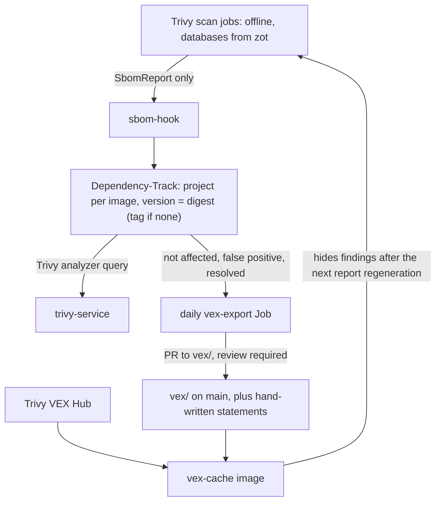

# Security posture

Facts for judging whether a vulnerability is exploitable here (Dependency-Track VEX, Trivy findings). Read from the manifests; paths are named, so read them for detail. What lives in Cloudflare, GitHub, Omni or the router is *outside the repo*.

## Cluster

- Three control-plane nodes run all workloads. Talos through Omni. Cilium replaces the CNI and kube-proxy; KubePrism and hostDNS are on.
- `UserNamespacesSupport` is on (`patches/08-feature-gate.yaml`) but no pod sets `hostUsers: false` (Cilium sets `true`): container UIDs are host UIDs.
- Flux reconciles `main` with cluster-admin (`cluster.multitenant: false`). `main` needs a PR with a code-owner approval (`docs/branch-protection.md`, *outside the repo*).

## Reachability

### Internet

Only through a Cloudflare tunnel (outbound `cloudflared` sidecar in the Traefik pod). Traefik is `ClusterIP` and serves plain HTTP on `:8000` on all pod addresses; its network policy admits no ingress, so isolation is the policy, not a loopback bind. `kubernetesCRD` provider only, no dashboard, access logs off. Routes: `k8s/apps/harper-pad/ingressroute.yaml`, `k8s/infra/post-workloads/*/`. Middlewares (rate limit, body size, headers) sit next to them.

| Hostname | Routed to | Control in front |
|---|---|---|
| `dtrack.portableinfo.cloud` | Dependency-Track frontend and api-server | Cloudflare Access (*outside the repo*), then Dependency-Track login or API key |
| `harper-sync.portableinfo.cloud` | `harper-pad-sync` | Traefik middlewares; DPoP proof |
| `flux-hook.portableinfo.cloud` | Flux `webhook-receiver`, `/hook/` only | No Access by design. GitHub HMAC, rate limit per `Cf-Connecting-Ip` |
| harper-pad admin | `harper-pad-admin`, own sidecar | Cloudflare Access with OIDC (*outside the repo*). No Service, no Traefik route |
| `shared-files.portableinfo.cloud` | R2 bucket, not the cluster | Public downloads |

### LAN (192.168.1.0/24)

MetalLB L2 pool `192.168.1.221-254`, `autoAssign: false`. Cilium LB-IPAM and L2 announcements are off.

| Address | Service | Admitted by the network policy |
|---|---|---|
| `.240` | zot registry, 5000 TLS (internal CA) | `world`, host, remote-node, kube-apiserver. No `auth` or `accessControl` |
| `.242` | Dependency-Track API, 8080 HTTP | `world`, host, remote-node, kube-apiserver. Own keys and logins |
| `.243` | Prometheus, 80 HTTP | `192.168.1.0/24`. Whole HTTP API (admin API off), no authentication |
| `.244` | `claude-vm-upgrade` poll listener, 80 HTTP | The two VM pods, host, remote-node. VM API paths need the per-VM token (*Virtual machines*), else 401; `/healthz` needs none |
| `.245` | `claude-urlshare` API, 80 | `192.168.1.0/24` |
| `.246` / `.247` | SSH to `claude-vm` / `homeserver-vm` | `192.168.1.0/24` |
| `.253` | AdGuard Home DNS, 53, 853, 443 | `world`, `cluster` |

Host-network pods listen on node addresses and no pod policy covers them; node-exporter serves plain HTTP on `<node IP>:9100`. LAN reach to node addresses is the router's call (*outside the repo*).
Policies: `networkpolicy.yaml` next to each workload.

### Omni service exposer

Services annotated `omni-kube-service-exposer.sidero.dev/*` (grep for it) are published by Omni's exposer on the host network (traffic arrives as `host` or `remote-node`). Access control is Omni's login (*outside the repo*). `claude-elevate` is one of them and grants break-glass RBAC.

## Network

- Cilium enforces policy on every endpoint, with WireGuard. No `hostFirewall`, no `egressGateway`.
- Not endpoints, so no policy: Cilium, MetalLB speaker and `frr-k8s`, node-exporter, Omni exposer, control-plane static pods.
- Namespaces start from default deny (`endpointSelector: {}`) plus per-workload allows. Own shapes: `kube-system`, `flux-system`, `harper-pad`.
- Egress is an allowlist (kube-dns, the API where needed, `toFQDNs`), except:
  - `claude-vm`, `homeserver-vm`, CDI importer pods: any destination. `claude-vm`'s own gateway (*outside the repo*) limits the agent users to a host list; `homeserver-vm` has none.
  - `claude-urlshare`: any public address on TCP 80 and 443. `harper-pad-admin`: any public address on 7844 and 443.
  - `arc-runners-system`: about 80 named hosts (GitHub, registries, package hosts, mirrors, Sigstore).
- Ingress from outside the pod network is per policy: `world` (zot, Dependency-Track api-server, AdGuard), `host` and `remote-node` (exposer, kubelet probes, some node-to-pod flows), `kube-apiserver` (webhooks), `192.168.1.0/24` (Prometheus, `claude-urlshare`, VM SSH).

## Pod security

### Pod Security Admission

Every namespace sets its level (`grep -r pod-security.kubernetes.io k8s`) except `kube-system` and `flux-system`, which get Talos's built-in default (enforce `baseline`, audit and warn `restricted`, `kube-system` exempt), set *outside the repo*. Not `restricted`:

- `baseline`: `policy-system`, `dependency-track-system`, `arc-controller-system`, `cdi`, `adguard-system`, `trivy-system`, `kubevirt-system`, `claude-vm`, `homeserver-vm`.
- `privileged`: `arc-runners-system`, `metallb-system`, `openebs-system`, `registry-system`, `kubevirt`, `kube-prometheus-stack-system`.

Pods created at runtime (CNPG, ARC, Kyverno, CDI, Trivy scan jobs) are not in the repo; their namespace's level applies.

### Container baseline

Workloads written here, and charts configured to match, set `runAsNonRoot`, `readOnlyRootFilesystem`, `allowPrivilegeEscalation: false`, `capabilities.drop: [ALL]`, `seccompProfile: RuntimeDefault`. CI fails below a 100 Polaris score; each deviation is an exemption with its reason in `k8s/infra/policy-system/polaris/helm-release.yaml`.
A read-only root filesystem does not cover volumes: check `volumeMounts` before ruling out a write (`claude-rc` mounts `/home/claude`, `/workspace`, `/tmp` writable).
Service account tokens are not mounted on most workloads written here (`automountServiceAccountToken: false`); other pods get the default token.

### Exceptions

Beyond the Polaris exemptions, Cilium is in `k8s/infra/cilium/rendered/`:

- Host network: Cilium agent, Envoy, operator; MetalLB speaker, `frr-k8s`, node-exporter (also reads host `/`, `/proc`, `/sys`), Omni exposer, Talos static pods.
- Cilium agent: `NET_ADMIN`, `SYS_ADMIN`, `SYS_RESOURCE` and more, seccomp `Unconfined`, hostPath `/proc`, `/sys/fs/bpf`, `/sys/fs/cgroup`; privileged `mount-bpf-fs` init container.
- Privileged, root, hostPath `/dev`: OpenEBS LVM node plugin, KubeVirt `virt-handler` (also host PID).
- Root: Spegel (containerd socket, content store), CoreDNS, MetalLB speaker, `frr-k8s`, Omni exposer. Privilege escalation allowed: `frr-k8s`, Omni exposer, AdGuard Home.
- Writable root filesystem: `virt-operator`, `cdi-operator`, CDI pods, `frr-k8s`, Omni exposer.

### CI runners (`arc-runners-system`, `privileged`)

Specs are in HelmRelease values (`k8s/apps/arc-runner/`), not `rendered/`.

- All scale sets except `arc-files-bootc` have a privileged container; `arc-ubuntu`, `arc-ubuntu-podman`, `arc-iso-bootc` also mount hostPath `/dev` (root on the node).
- `arc-iso-bootc` and `arc-e2e-talos-gitops` serve public repositories.
- All except `arc-e2e-talos-gitops` can read `FILESERVER_TOKEN` (fileserver upload).
- Controls *outside the repo*: owner-only write access, approval for outside collaborators' runs, `environment: file-upload`.

### Virtual machines

- `claude-vm` and `homeserver-vm` run in KubeVirt (masquerade; `claude-vm` forwards only port 22). Both namespaces opt in to the `ops` and `storage` elevate tiers.
- `claude-vm` holds the same GitHub App credential as the `claude-rc` pod, via cloud-init.
- The VMs poll `claude-vm-upgrade` over plain HTTP. Their egress policy sends port 80 to `192.168.1.244` through Cilium's Envoy, which sets `X-Upgrade-Token` from a Secret in `cilium-secrets`, overwriting what the VM sent. The token is not in the VM.
  On VM API paths the listener answers 401 unless the header matches the token of the VM in the path, so a VM acts only as itself. `/healthz` needs no token; sources the network policy rejects get no answer.
  Anything inside a VM can still make requests that get its token injected; a host in the path could answer `{"upgrade": true}`; the token is compared with `==` (`k8s/apps/claude-system/README.md`).

## Admission control

| Policy | Engine | On outage | Checks |
|---|---|---|---|
| `cthtrifork-images` | Kyverno | Blocks | Our images (`ghcr.io/cthtrifork/talos-gitops/**`, `harper-pad-*`) carry a keyless cosign signature from `main`, verified against Rekor. No namespace exempt |
| `deny-world-egress` | Kyverno | Allows | Cilium policies may not allow `world` or `all`. Not applied in the VM namespaces. CIDR rules and Kubernetes NetworkPolicies not checked |
| `require-helmrelease-remediation` | Kyverno | Allows | Operational only |
| `require-namespace-psa-enforce` | Native VAP | Blocks | Every Namespace sets a PSA enforce level. Exempt: system namespaces, `flux-system` |
| `require-image-digest` | Native VAP | Blocks | Every container, init and ephemeral image has `@sha256:`. Exempt in `kube-system`: Talos and Omni generated pods |

Kyverno policies run at admission only; running pods are not re-evaluated. Files: `k8s/infra/{image-policies,policy-system}/`. The elevate page adds blocking VAPs that bound its grants (`k8s/apps/claude-system/elevate/`).

## Identity and RBAC

- Flux is cluster-admin. Roles that can `pods/exec` (named in the Polaris exemptions): the Flux cluster-admin bindings, `flux-web-admin`, `flux-web-user` (wildcard read), the `cloudnative-pg` and `kubevirt-operator` operators, the `claude-debug` tier.
- `claude-rc` ServiceAccount `claude`: built-in `view` (no Secrets) plus read of nodes, PVs, StorageClasses, CRDs, ClusterRoles and bindings. No write verbs, no `pods/exec` (`k8s/apps/claude-system/rbac.yaml`).
- The `claude-rc` pod also holds: the claude.ai login on a PVC; a one-hour GitHub App installation token (Contents, Pull requests, Workflows read/write on installed repositories); an Omni service account with role Reader (TTL 365 days); the Dependency-Track key of the `claude-triage` team (analysis read/create/update; no BOM upload, no admin); optionally a `read:packages` GHCR token and a read-only Cloudflare API token.
- Elevate tiers (`ops`, `debug`, `storage`, `flux`; `k8s/apps/claude-system/clusterrole-elevated.yaml`) are bound per opted-in namespace (`claude-elevate/<tier>` label) by `claude-elevator` for a short-lived token. No tier patches workloads except `debug` on `pods/ephemeralcontainers`. `debug` (`pods/exec`, `attach`, `portforward`) is opted in by `adguard-system` only.
- `claude-elevator` can create ServiceAccounts, RoleBindings, Jobs and tokens cluster-wide; the VAPs pin `bind`, `patch`, `delete` and `token` to the tier names.

## Secrets

- Committed secrets are SOPS/age encrypted (`.sops.yaml`), checked in CI. Flux decrypts with `flux-system/sops-age`; the age key is outside Git.
- Generated secrets never enter Git (Dependency-Track KEK and admin password, fileserver upload token, per-VM poll tokens, Garage keys). They come from External Secrets in `secret-store`, a ClusterSecretStore usable only from `secret-store`, `renovate-system`, `dependency-track-system`, `fileserver-system`, `arc-runners-system`, `claude-system`, `cilium-secrets`; its ServiceAccount reads and writes Secrets in `secret-store` only.
- Losing the Dependency-Track KEK makes its encrypted content unreadable.
- Certificates: internal CA (`portableinfo-root-ca`) for zot, Hubble and the runners' trust bundle; Let's Encrypt DNS-01 through Cloudflare for AdGuard. harper-pad's database uses client certificates.

## Supply chain

- Renovate pins digests and automerges patch and digest updates, except components listed in `renovate.json5`.
- Pull path: containerd, Spegel, zot, upstream (`docs/registry-mirrors.md`). Container images pin digests, so the mirror cannot change what runs. Pulled by tag instead: the VM disks (`*-containerdisk:latest`, imported by CDI) and the Trivy `vex-cache:latest` volume.
- Images built here are signed keyless with cosign, attested and scanned with Trivy (`.github/workflows/`).

### Vulnerability data flow

- Trivy scans running workloads with `scanners: [vuln]` (exposed-secret scanning off). `arc-runners-system` and `arc-controller-system` are excluded. No scan of the Talos OS or VM guests.
- Trivy ignores `will_not_fix` and `not_affected`; its ignore file and Rego policy are empty. Scan jobs are offline and reach only the Trivy server and zot.
- A hidden finding need not come from a Dependency-Track decision (VEX Hub, hand-written statements). Only `Dependency-Track`-authored documents are exported, via a GitHub App PR that `main` review gates. Trivy matches statements by PURL and digest, so a decision on a tag-versioned project is not exported (`vex/README.md`).

## Using this for a CVE

| If the vulnerability needs | Fact |
|---|---|
| Network access from the internet | Only the five *Internet* entries; the rest has default-deny ingress |
| Network access from the LAN | The LAN table plus host-network listeners (node-exporter 9100); others accept pod and node traffic as listed |
| A connection out to an attacker host | FQDN allowlist, except the VMs, `claude-urlshare`, `harper-pad-admin`; broad list for runners (*Network*) |
| A writable root filesystem, root, capabilities, privileged container, node access | Only the *Exceptions* and the runners; volumes can still be writable (*Container baseline*) |
| A service account token | Not mounted on listed pods; otherwise check the pod's ServiceAccount |
| Reading Secrets across namespaces | `claude` cannot read Secrets; `secret-store` reads only its own namespace |
| A shell in a pod | `pods/exec` holders in *Identity and RBAC* |
| A changed image or tag | Digest required by a native VAP; our own images also need a cosign signature (*Admission control*) |
