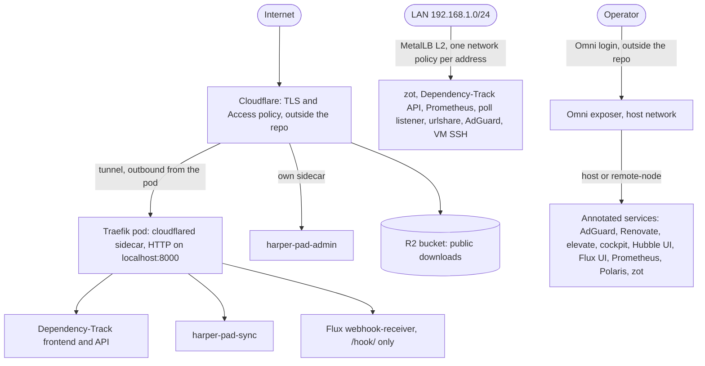
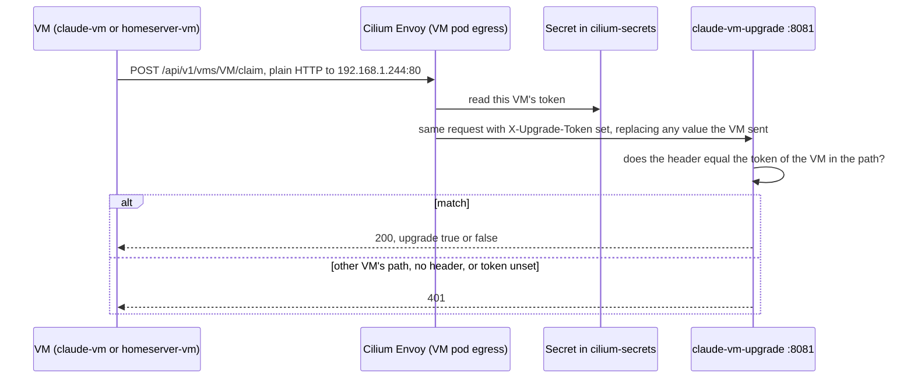
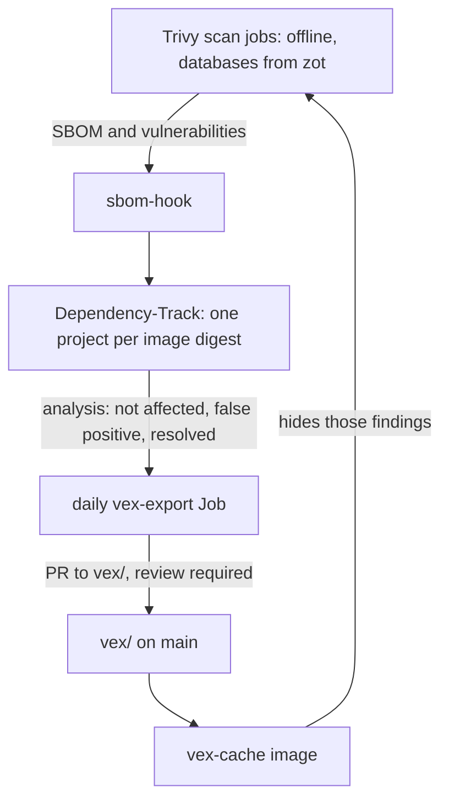

# Security posture

Facts for deciding whether a vulnerability is exploitable here (VEX decisions in Dependency-Track, Trivy findings).
Everything is read from the manifests; the file is named next to it. What lives in Cloudflare, GitHub or Omni is not visible in the repo and is marked *outside the repo*.

## Cluster

- Three nodes, all control plane; workloads run on them (`patches/13-lb-node-labels.yaml`). Talos Linux through Omni.
- Cilium replaces the CNI and kube-proxy (`kubeProxyReplacement: true`). KubePrism and Talos hostDNS are on.
- `UserNamespacesSupport` is on (`patches/08-feature-gate.yaml`); no manifest sets `hostUsers`.
- Flux reconciles `main` of `cthtrifork/talos-gitops` with cluster-admin (`cluster.multitenant: false`, `k8s/clusters/homelab/flux-instance.yaml`).
  `main` needs a PR with a code-owner approval (`docs/branch-protection.md`, *outside the repo*).

## Reachability

Three ways in. The detail and the controls are in the sections below.

### Internet

All public traffic enters through a Cloudflare tunnel (outbound `cloudflared` sidecar in the Traefik pod). Traefik is `ClusterIP` with no ingress rule, listens on plain HTTP on `localhost:8000`, and has access logs off.
It allows `kubernetesCRD` only, no cross-namespace references, no dashboard (`k8s/infra/controllers/ingress-system/`).

| Hostname | Routed to | Control in front |
|---|---|---|
| `dtrack.portableinfo.cloud` | Dependency-Track frontend, `/api` to the api-server | Cloudflare Access (*outside the repo*) plus Dependency-Track login and API keys |
| `harper-sync.portableinfo.cloud` | `harper-pad-sync` | Traefik middlewares (headers, rate limit, body size); the API demands a DPoP proof. `/readyz` is not routed |
| `flux-hook.portableinfo.cloud` | Flux `webhook-receiver`, `/hook/` only | No Cloudflare Access by design. Path derived from the token, GitHub HMAC required, 5 req/s (burst 10) per `Cf-Connecting-Ip`, 25 MiB body |
| harper-pad admin | `harper-pad-admin` on loopback via its own `cloudflared` sidecar | Cloudflare Access with OIDC (*outside the repo*). No Service, no Traefik route |
| `shared-files.portableinfo.cloud` | Cloudflare R2 bucket, not the cluster | Public downloads; `r2-sync` copies `public/` to the bucket |

### LAN (192.168.1.0/24)

MetalLB L2 pool `192.168.1.221-254`, `autoAssign: false`. Cilium LB-IPAM and L2 announcements are off.

| Address | Service | Port | Admitted by the network policy |
|---|---|---|---|
| `.240` | zot registry | 5000, TLS (internal CA) | `world`, host, remote-node, kube-apiserver. `zot.json` has no `auth` or `accessControl` |
| `.242` | Dependency-Track API | 8080, plain HTTP | `world`, host, remote-node, kube-apiserver. Dependency-Track's own keys and logins |
| `.243` | Prometheus | 80, plain HTTP | `192.168.1.0/24` on 9090. Whole HTTP API (admin API off), no authentication |
| `.244` | `claude-vm-upgrade` poll listener | 80 (pod 8081), plain HTTP | The two VM pods, host, remote-node. The listener requires a per-VM `X-Upgrade-Token` (see *Virtual machines*); other sources get 401 |
| `.245` | `claude-urlshare` API | 80 (pod 8081) | `192.168.1.0/24` |
| `.246` / `.247` | SSH to `claude-vm` / `homeserver-vm` | 22 | `192.168.1.0/24` |
| `.253` | AdGuard Home DNS | 53, 853, 443 | `world` and `cluster` |

Policies: `k8s/infra/{registry-system,dependency-track-system,kube-prometheus-stack}/networkpolicy.yaml`, `k8s/apps/{claude-system,adguard}/networkpolicy.yaml`, `k8s/virtualmachines/*/networkpolicy.yaml`.

### Omni service exposer

Services annotated `omni-kube-service-exposer.sidero.dev/*` are published by Omni's exposer (host network, so traffic arrives as `host` or `remote-node`). Access control is Omni's login (*outside the repo*).
Annotated: AdGuard web, Renovate UI, `claude-elevate`, `claude-usage`, `claude-cockpit`, `claude-urlshare`, `claude-vm-upgrade` page, fileserver admin, Hubble UI, Flux Operator UI, Prometheus, Polaris, zot.
`claude-elevate` grants break-glass RBAC (see *Identity and RBAC*).

## Network

- Cilium enforces policy on every endpoint, with WireGuard encryption. No `hostFirewall`, no `egressGateway`.
- Host-network pods are not endpoints and no policy covers them: Cilium, MetalLB speaker and `frr-k8s`, node-exporter, Omni exposer, control-plane static pods.
- Namespaces start from default deny (`endpointSelector: {}`) and add per-workload allows. `kube-system`, `flux-system` and `harper-pad` have their own policy shape (`k8s/infra/post/kube-system/`, `k8s/infra/flux-system/`, `k8s/apps/harper-pad/`).

### Egress

An allowlist of kube-dns, the Kubernetes API where needed, and named hosts (`toFQDNs`), except:

- `claude-vm`, `homeserver-vm` and the CDI importer pods in their namespaces: any destination. `claude-vm`'s own gateway (nftables, nginx, dnsmasq; *outside the repo*) limits the agent users to a host list; `homeserver-vm` has none.
- `claude-urlshare`: any public address on TCP 80 and 443. `harper-pad-admin`: any public address on 7844 and 443.
- `arc-runners-system`: about 80 named hosts (GitHub, registries, package hosts, mirrors, Sigstore).

### Ingress from outside the pod network

`world`: zot, Dependency-Track api-server, AdGuard. `host` and `remote-node`: Omni exposer, kubelet probes, some node-to-pod flows. `kube-apiserver`: webhook receivers.
`cluster`: Flux, AdGuard DNS. `192.168.1.0/24`: Prometheus 9090, `claude-urlshare` 8081, VM SSH.

## Pod security

### Pod Security Admission

Labels are on each namespace (`grep -r pod-security.kubernetes.io k8s`). Enforced level:

- `restricted`: the application namespaces, `cert-manager-system`, `traefik-system`, `cnpg-system`, `reloader-system`, `external-secrets-system`, `external-dns-system`, `secret-store`, `cilium-secrets`.
- `baseline`: `policy-system`, `dependency-track-system`, `arc-controller-system`, `cdi`, `adguard-system`, `trivy-system`, `kubevirt-system`, `claude-vm`, `homeserver-vm`.
- `privileged`: `arc-runners-system`, `metallb-system`, `openebs-system`, `registry-system`, `kubevirt`, `kube-prometheus-stack-system`.
- Unlabelled: `kube-system` (exempt) and `flux-system`, which get the Talos API-server default (enforce `baseline`, audit and warn `restricted`).

Pods created at runtime (CNPG, ARC, Kyverno, CDI, Trivy scan jobs) are not in the repo; their namespaces' levels are set for them.

### Container baseline

Workloads written here, and the charts configured to match, set `runAsNonRoot`, `readOnlyRootFilesystem: true`, `allowPrivilegeEscalation: false`, `capabilities.drop: [ALL]` and `seccompProfile: RuntimeDefault`.
CI audits `k8s/` with Polaris and fails below 100 (`.github/workflows/validate.yaml`). Every deviation is an exemption with its reason in `k8s/infra/policy-system/polaris/helm-release.yaml`.

Service account tokens are not mounted on most workloads written here (`automountServiceAccountToken: false` in their manifests); other pods get the default token.

### Exceptions

Workloads that run as root, privileged, on the host network or with host paths (reasons in the Polaris exemptions, Cilium in `k8s/infra/cilium/rendered/`):

- Cilium agent, Envoy and operator: host network; the agent has `NET_ADMIN`, `SYS_ADMIN`, `SYS_RESOURCE` and more, seccomp `Unconfined`, hostPath `/proc`, `/sys/fs/bpf`, `/sys/fs/cgroup`.
- MetalLB speaker and `frr-k8s`, node-exporter, Omni exposer, Talos static pods: host network. node-exporter also reads host `/`, `/proc`, `/sys`.
- OpenEBS LVM node plugin and KubeVirt `virt-handler`: privileged, root, hostPath `/dev`; `virt-handler` also host PID.
- Spegel: root, containerd socket and content store.
- Writable root filesystem: `virt-operator`, `cdi-operator`, CDI pods, Omni exposer.
- AdGuard Home: `allowPrivilegeEscalation: true` for a file capability.

### CI runners (`arc-runners-system`, `privileged`)

Pod specs are in HelmRelease values (`k8s/apps/arc-runner/`), not in `rendered/`.

- Every scale set except `arc-files-bootc` has a privileged container; `arc-ubuntu`, `arc-ubuntu-podman` and `arc-iso-bootc` also mount hostPath `/dev`. A privileged pod with hostPath `/dev` is root on the node.
- `arc-iso-bootc` and `arc-e2e-talos-gitops` serve public repositories.
- All scale sets except `arc-e2e-talos-gitops` can read `FILESERVER_TOKEN` (upload access to the fileserver).
- The controls are *outside the repo*: write access limited to the owner, approval for outside collaborators' runs, `environment: file-upload` on uploads.

### Virtual machines

- `claude-vm` and `homeserver-vm` run in KubeVirt (masquerade; `claude-vm` forwards only port 22). Both namespaces opt in to the `ops` and `storage` elevate tiers.
- `claude-vm` holds the same GitHub App credential as the `claude-rc` pod, seeded through cloud-init.
- The VMs poll `claude-vm-upgrade` over plain HTTP with a per-VM token. The token is not in the VM: the VM's egress policy sends port 80 to `192.168.1.244` through Cilium's Envoy, which sets `X-Upgrade-Token` from a Secret in `cilium-secrets` (overwriting any value the VM sends).
  The listener answers 401 unless the header matches the token of the VM in the path, so a VM acts only as itself. Anything running inside a VM can still make requests that get its token injected, a host in the path could answer `{"upgrade": true}`, and the token is compared with `==` (`k8s/apps/claude-system/README.md`).

## Admission control

| Policy | Engine | On outage | Checks |
|---|---|---|---|
| `cthtrifork-images` | Kyverno | Blocks (`Fail`) | Images `ghcr.io/cthtrifork/talos-gitops/**` and `ghcr.io/cthtrifork/harper-pad-*` carry a keyless cosign signature from `main` of `talos-gitops` (or `harper-pad`), verified against Rekor. No namespace exempt; verifies `images.containers` |
| `deny-world-egress` | Kyverno | Allows (`Ignore`) | Cilium policies may not allow `world`, `world-ipv4`, `world-ipv6` or `all`. Not applied in the VM namespaces. CIDR rules and Kubernetes NetworkPolicies are not checked |
| `require-helmrelease-remediation` | Kyverno | Allows | HelmReleases set retries. Operational only |
| `require-namespace-psa-enforce` | Native VAP, `Fail` | API server | A Namespace needs `pod-security.kubernetes.io/enforce` of `privileged`, `baseline` or `restricted`. Exempt: system namespaces and `flux-system` |
| `require-image-digest` | Native VAP, `Fail` | API server | Every container, init and ephemeral image contains `@sha256:`. Exempt in `kube-system`: Talos and Omni generated pods. Matches `pods`, not `pods/ephemeralcontainers` |

- Kyverno policies run at admission only (`evaluation.background.enabled: false`); running pods are not re-evaluated. Two admission-controller replicas. Files: `k8s/infra/{image-policies,policy-system}/`.
- The elevate page adds VAPs (`k8s/apps/claude-system/elevate/`, all `Fail`) that bound its grants: see *Identity and RBAC*.

## Identity and RBAC

- Flux is cluster-admin. Roles that can `pods/exec` (named in the Polaris exemptions): the Flux cluster-admin bindings, `flux-web-admin`, `flux-web-user` (wildcard read), the `cloudnative-pg` operator, and the `claude-debug` tier.
- `claude-rc` ServiceAccount `claude`: built-in `view` (no Secrets) plus read of nodes, PVs, StorageClasses, CRDs, ClusterRoles and bindings. No write verbs, no `pods/exec` (`k8s/apps/claude-system/rbac.yaml`).
- The `claude-rc` pod also holds: the claude.ai login on a PVC; a one-hour GitHub App installation token (Contents, Pull requests, Workflows read/write on installed repositories); an Omni service account with role Reader (TTL 365 days);
  the Dependency-Track key of the `claude-triage` team (analysis read/create/update; no BOM upload, no admin); optionally a `read:packages` GHCR token and a read-only Cloudflare API token.
- Elevate tiers (`ops`, `debug`, `storage`, `flux`) are ClusterRoles bound per opted-in namespace (`claude-elevate/<tier>` label) by `claude-elevator` for a short-lived token (`k8s/apps/claude-system/elevate/configmap.yaml`). No tier can patch workloads; `flux` patches annotations on HelmReleases and Kustomizations only. `debug` (`pods/exec`) is opted in by `adguard-system` only. Jobs from a CronJob are allowed only in `dependency-track-system`.
- `claude-elevator` can create ServiceAccounts, RoleBindings, Jobs and tokens cluster-wide; `bind`, `patch`, `delete` and `token` are pinned to the four tier names, and the VAPs bound where they apply.

## Secrets

- Committed secrets are SOPS/age encrypted (`.sops.yaml`; 16 `*.enc.yaml`). CI checks this (`scripts/ci/check-secrets-encrypted.sh`). Flux decrypts with `flux-system/sops-age`; the age key is kept outside Git.
- Generated secrets never enter Git: the Dependency-Track KEK and admin password, the fileserver upload token, the per-VM poll tokens and the Garage keys come from External Secrets in `secret-store` (`k8s/infra/secret-store/`).
  The `secret-store` ClusterSecretStore is usable only from `secret-store`, `renovate-system`, `dependency-track-system`, `fileserver-system`, `arc-runners-system`, `claude-system` and `cilium-secrets`. Its ServiceAccount reads and writes Secrets in `secret-store` only.
- Losing the Dependency-Track KEK makes its encrypted content unreadable.
- Certificates: an internal CA (`portableinfo-root-ca`) for zot, Hubble and the runners' trust bundle; Let's Encrypt DNS-01 through Cloudflare for AdGuard. harper-pad's database uses client certificates, no passwords.

## Supply chain

- Renovate pins digests and automerges patch and digest updates, except for the components listed in `renovate.json5`.
- Image pull path: containerd, Spegel, zot, upstream (`docs/registry-mirrors.md`). Manifests pin digests, so the mirror path cannot change what runs.
- Images built here are signed keyless with cosign, attested, and scanned with Trivy (`.github/workflows/`).

### Vulnerability data flow

- Trivy scans running workloads with `scanners: [vuln]` (exposed-secret scanning off). `arc-runners-system` and `arc-controller-system` are excluded. No scan of the Talos OS or VM guest operating systems is configured.
- Trivy ignores `will_not_fix` and `not_affected`; its ignore file and Rego policy are empty. Scan jobs are offline and reach only the Trivy server and zot.
- Only `Dependency-Track`-authored VEX documents are exported (`vex/README.md`); the export opens a PR as a GitHub App and `main` still needs review. Trivy matches a statement by PURL and digest, so a decision on a tag-versioned project is not exported.

## Using this for a CVE

| If the vulnerability needs | Fact | Section |
|---|---|---|
| Network access from the internet | Only the five entries under *Internet*; everything else has default-deny ingress | Reachability |
| Network access from the LAN | Only the LAN table; other services accept pod and node traffic as listed | Reachability |
| A connection out to an attacker host | FQDN allowlist for most namespaces; open for the VMs, `claude-urlshare`, `harper-pad-admin`; broad list for runners | Egress |
| Writing to the container filesystem, root, extra capabilities, a privileged container, node access | Not available except the exceptions table and the runners | Exceptions, runners |
| A service account token | Not mounted on the listed pods; otherwise check the pod's ServiceAccount | Container baseline |
| Reading Secrets across namespaces | `claude` cannot read Secrets; `secret-store` reads only its own namespace | Identity and RBAC |
| A shell in a pod | `pods/exec` is in the `debug` tier (`adguard-system` only), Flux, `flux-web-*` and the CloudNativePG operator | Identity and RBAC |
| A changed image or tag | Digests required by a native VAP (fail-closed); our own images also need a cosign signature (Kyverno, fail-closed) | Admission control |
