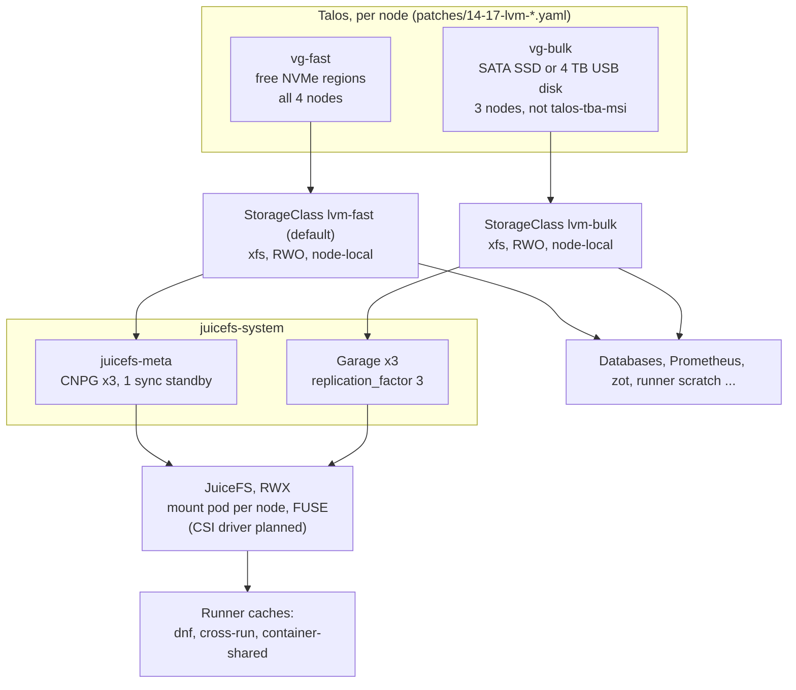

# Storage (OpenEBS LVM and JuiceFS)

Two tiers: node-local volumes for almost everything (OpenEBS LVM, ReadWriteOnce), and one shared ReadWriteMany filesystem for the runner caches (JuiceFS, built on the first tier).

## OpenEBS LVM (`k8s/infra/openebs-system/`)

- The volume group is the tier: `vg-fast` is NVMe, `vg-bulk` slower disks. Talos builds them from free disk regions (`patches/14-lvm-2jc.yaml` to `17-lvm-11a.yaml`). `talos-tba-msi` has no `vg-bulk`.
- A volume lives on one node and has no redundancy and no thin provisioning. `WaitForFirstConsumer` lets the pod's node pick where it is created, and a pod cannot move to another node without its data. Check free space per group with `lvm_vg_free_size_bytes`; `openebs-system/prometheusrule.yaml` alerts below 20% (warning) and 10% (critical).
- Volumes expand (`allowVolumeExpansion`), never shrink.

## JuiceFS (`k8s/apps/juicefs-system/`)

- It gives the ARC runners caches that every runner shares, whichever node it lands on. Image storage stays on local volumes: overlay on FUSE is a bad idea.
- Metadata (files, directories) is in PostgreSQL, data blocks are in Garage. Both run three copies on different nodes: one node lost keeps Garage's quorum (2 of 3) and CNPG promotes a replica; two lost stops Garage. No backups, the data is CI caches.
- Sizes follow the peak use of the shared caches over 3 days (4.0 GiB in about 1.4k files): Garage 10 Gi data and 1 Gi metadata per node, 2 Gi per PostgreSQL instance.
- Monitoring: the pods carry `prometheus-scrape: "true"`; `prometheusrule.yaml` alerts on a missing Garage node, lost quorum, a missing PostgreSQL instance and replication lag. `PersistentVolumeAlmostFull` covers the volumes.

### Growing a JuiceFS volume

Everything is a change in Git, nothing is run by hand.

- **PostgreSQL:** raise `storage.size` in `postgres-cluster.yaml`. The operator resizes every PVC, online on OpenEBS LVM.
- **Garage:** raise the three `data-garage-<n>` sizes in `garage/pvc.yaml` and `clusterConfig.layout.capacity` in `garage/helm-release.yaml`, in one PR. Flux expands the PVCs online and the configure hook assigns the new capacity. Each node holds a full copy, so the usable space is that of the smallest one.
- Never change `persistence.*.size` in the HelmRelease. Garage is a StatefulSet and its `volumeClaimTemplates` are immutable (Kubernetes v1.37), which a Helm retry does not fix (`docs/helmrelease-conventions.md`). That is why the claims are in `pvc.yaml`: the StatefulSet creates a claim only if it is missing and never resizes it, so a claim from Git with the template's name is used as is.
- Do not run `garage layout apply` by hand at the same time: two applies of the same `--version` leave the cluster inconsistent.

## Which to use

Default to `lvm-fast`; `lvm-bulk` for large, cold data. Use JuiceFS only where several pods on different nodes must write the same files, and not for databases or container image storage.
