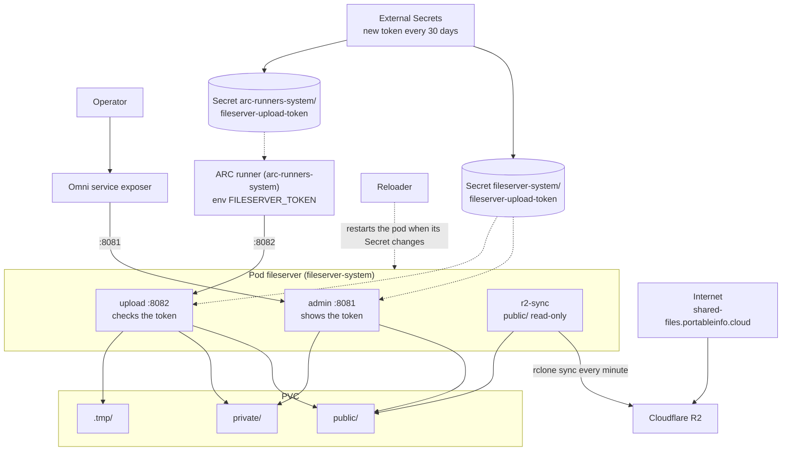

# fileserver

An admin page and a CI upload API in one static Go binary with no dependencies. State is the directory a file is
in, so there is no database. The pod (`k8s/apps/fileserver`) runs the `admin` and `upload` modes as two containers, plus an `r2-sync`
container that copies `public/` to Cloudflare R2, which serves the downloads.

| Mode | Port | Mounts | What it does |
|---|---|---|---|
| `--mode=public` | 8080 | `public/` read-only | `GET /<name>`, no listing. Not deployed: R2 serves the downloads |
| `--mode=admin` | 8081 | everything | List, upload, download, delete, move between public and private, show the upload token. No login: only Omni reaches it |
| `--mode=upload` | 8082 | everything | `PUT /v1/files/<name>?visibility=public\|private` with the bearer token. Cluster-internal |

## Rules

- **Names** are one plain name: `fs.ValidPath`, at most 255 bytes, no `/` or `\`, no control characters, not starting with `.`.
  Every access goes through `os.Root`, so a name cannot leave its directory.
- **Visibility is the directory.** A name lives in only one of `public/` and `private/` (409 otherwise). Uploading the same name with
  the same visibility replaces the file. Uploads default to private.
- **Writes are atomic**: streamed to `.tmp/`, `fsync`ed every 64 MiB, renamed into place. An optional `X-Content-SHA256` header is
  checked before the rename (422 on a mismatch).
- **Limits**: `MAX_FILE_BYTES` per file (413), `MIN_FREE_BYTES` must stay free (507).
- **Downloads are never pages**: `application/octet-stream`, `attachment`, `nosniff`, `CSP: sandbox`.

## Upload token

External Secrets writes a new token into the Secret every 30 days (`current` and `rotated-at`); Reloader restarts the pod. The app only
reads the mounted files. Only the upload API accepts the token, and the admin page shows it.

## Metrics

`/metrics` and `/healthz` are on `HEALTH_ADDR`, which Omni does not route to: requests, uploads by result, files, free disk
and the last token rotation.

## Configuration

| Variable | Default | Modes |
|---|---|---|
| `DATA_DIR` | `/data` | admin, upload |
| `PUBLIC_DIR` | `$DATA_DIR/public` | public |
| `LISTEN_ADDR` | `:8080`, `:8081`, `:8082` | all |
| `HEALTH_ADDR` | `:9102` | all |
| `MAX_FILE_BYTES` | 8 GiB | admin, upload |
| `MIN_FREE_BYTES` | 256 MiB | admin, upload |
| `TOKEN_DIR` | `/var/run/fileserver-token` | admin, upload |
| `PUBLIC_URL` | none: "Copy link" for public files | admin |
| `UPLOAD_URL` | none: "Copy curl" for the token | admin |

Run the tests with `go test -race ./...`.
