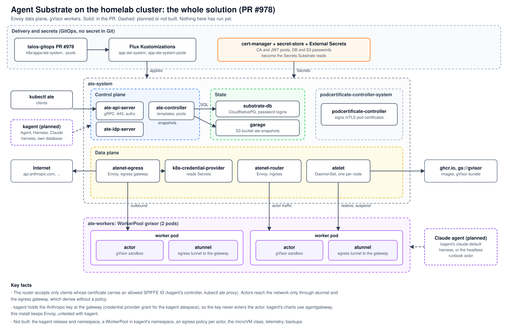
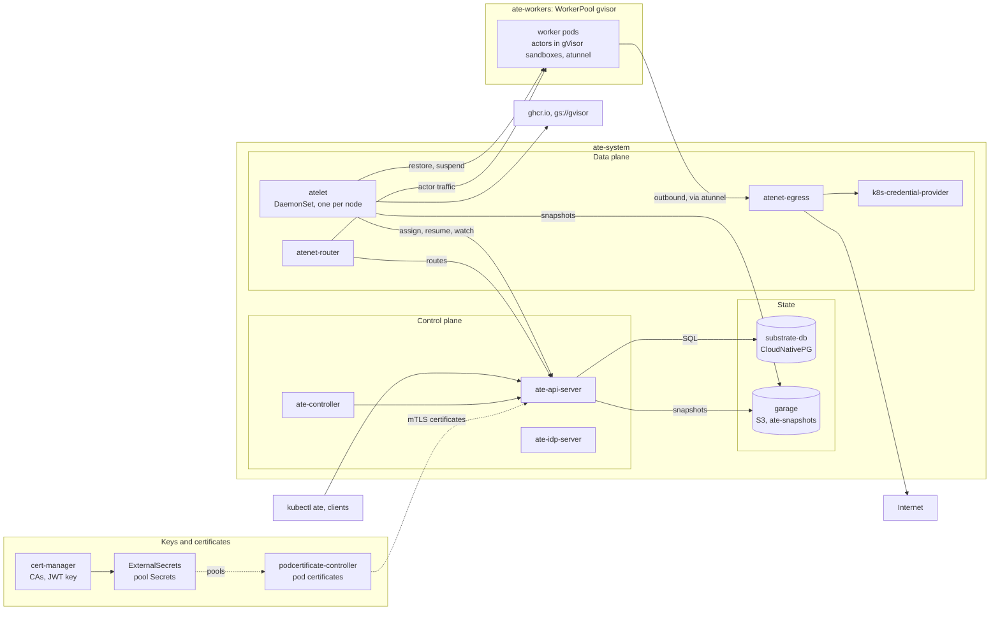

# Agent Substrate (ate-system)

[Agent Substrate](https://github.com/agent-substrate/substrate) runs sandboxed agents ("actors") on a small pool of warm worker pods
and snapshots idle actors to object storage. This directory is its control plane at **v1.0.1 of kagent's Helm charts** (github.com/kagent-dev/substrate, a build of
Substrate v1.0.0 plus charts), with gVisor as the only sandbox class. `k8s/apps/ate-system-pools/` has the `WorkerPool`; it waits for the CRDs installed here
(`app-ate-system` and `app-ate-system-pools` in `k8s/clusters/homelab/app-ate-system.yaml`).

Upstream `agent-substrate/substrate` ships install manifests but no Helm chart. The only charts are kagent's, and kagent 1.0 is tested against them, so this is
what is installed. They use **agentgateway** as the router and egress gateway; there is no Envoy option.

| Where | What |
|---|---|
| `crds/`, `podcert/`, `atelet/`, `substrate/` | One HelmRelease each: the CRDs, the pod certificate controller, atelet (a DaemonSet, upgraded before the API server) and the control and data plane. The values are the cluster-specific part: S3 instead of the bundled RustFS, the database Secrets, kagent's owner and router identity, the credential grant, the preview gates |
| `garage/` | Garage (S3) for the snapshots, in this namespace and separate from the one Renovate uses |
| `postgres-cluster.yaml` | CloudNativePG database for `ate-api-server` (Substrate's "bring your own database" layout, with password logins) |
| `externalsecrets.yaml` | Passwords and keys generated in `k8s/infra/secret-store/` (`ate-garage-*`, `ate-postgres-*`) and shaped into the Secrets the charts read: the two connection strings and the Garage key under the AWS variable names |
| `configmap.yaml` | `ate-api-authentication`, the one ConfigMap the chart mounts but does not create |
| `networkpolicy.yaml`, `ingress-networkpolicy.yaml` | Cilium egress policies, and the ingress allows the chart's policies lack for Garage and the database |
| `issuer.yaml`, `certificate.yaml`, `rbac.yaml`, `secretstore.yaml`, `externalsecrets-pools.yaml` | The CA and JWT key pools: cert-manager makes the keys, External Secrets builds the pool Secrets Substrate reads (see below) |
| `namespace.yaml` | `ate-system`, `podcertificate-controller-system` and `ate-workers` (the charts do not create namespaces) |

The render workflow rewrites `rendered/` in every directory that has both a `helm-release.yaml` and a `helm-repository.yaml`, so each chart has a directory of its
own, and nothing like that may be added at this level.

## Architecture

The same in text, for the Substrate parts only:

The API server is the only thing clients call. Actors run in gVisor sandboxes inside the worker pods; idle ones are snapshotted to Garage and restored
into any worker with room. An actor reaches the network only through `atunnel` and the egress gateway, which denies everything without a policy for that
actor. Nothing here has run yet, and there are no actors: see `docs/agent-substrate-claude-actor.md` for a first one.

## Ready for kagent

[kagent](https://kagent.dev) 1.0 runs its agents (including a Claude harness: the Claude Code binary plus an adapter) as Substrate actors, and requires Substrate
v1.0.0. This install sets what kagent's own installer sets on Substrate, taken from its `go/core/pkg/install/plan.go` and `helm/README.md`:

- the preview gates `PerTemplateSnapshotLocation` and `GoldenEgressPolicy` on the API server, the controller and atelet;
- kagent's controller (`spiffe://cluster.local/ns/kagent/sa/kagent-controller`) as a global owner (it creates atespaces) and as a router client;
- a credential-provider grant for the atespace `kagent` to the namespace `kagent`, so the egress gateway can inject the Anthropic key without it entering the actor.

Not done, because kagent is not installed here yet: the `kagent` namespace (label `ate.dev/api-access: "true"`, PodSecurity `privileged` if the chart creates its
worker pool there), a WorkerPool **in the agent's namespace** carrying `kagent.dev/worker-pool-name` and `kagent.dev/worker-pool-namespace` labels (kagent resolves
the pool in the Agent's namespace, so the pool in `ate-workers` is not used by it), the kagent Helm release and its database, and the egress MITM trust that kagent's
actors need (`egress-mitm.ate.dev` is projected into them).

One risk is left. kagent is built against `github.com/kagent-dev/substrate`, the fork these charts come from; the gRPC `api/` is identical to upstream v1.0.0, so a client is
compatible with either. The data plane is agentgateway, as kagent expects.

## The key pools

Substrate keeps its CAs (pod identity, service DNS, Postgres, actor identity, egress MITM) and the actor JWT signing key in pool Secrets in its
own format. `ate-setup` would generate them once and never renew them; here:

1. cert-manager issues each as a CA `Certificate` (`certificate.yaml`): five years, renewed a year early, `rotationPolicy: Never` so a renewal
   keeps the key and only issues a new certificate. The JWT key is a `Certificate` too; only its key is used.
2. An `ExternalSecret` per pool (`externalsecrets-pools.yaml`) reads that Secret through a namespaced `SecretStore` and writes the pool: a JSON
   document with the key and the root certificate as base64 DER, which is the body of the PEM files cert-manager gives. The format is
   `localca.Marshal` and `localjwtauthority.Marshal` in the Substrate sources.

Things to know:

- A pool is **rebuilt from the cert-manager Secret every hour** (`refreshInterval`). Do not edit one by hand, and rotate the JWT key through cert-manager
  (delete the `actor-id-jwt-source` Secret and cert-manager issues a new key, which becomes the only key in the pool; tokens signed by the old one stop verifying). Substrate's
  `kubectl ate admin add-jwt-key` rotation, which keeps the old key published for a day, does not survive the next refresh.
- A renewed CA certificate reaches the pods through the mounted Secret. The JWT pool is reread by the pods within a minute; whether the
  other pools are reread without a restart is not confirmed, so restart `podcertificate-controller` and the Substrate pods after a CA renewal.
- The JWT authority id is the fixed `"1"`; the installer uses the key's thumbprint. Nothing in the code requires that.
- The Secrets are created in `ate-system` and `podcertificate-controller-system`, which stay empty until cert-manager and External Secrets have run;
  the pods that mount a pool wait in `ContainerCreating` meanwhile.

## Updating to a new release

Renovate maintains the four charts (the `OCIRepository` tag and digest in each `helm-repository.yaml`) and Garage. `renovate.json5` groups the four Substrate charts into one pull
request with no automerge, because they are one release: the version skew policy upgrades atelet before the API server, and the CRDs must match both. The render workflow then
regenerates `rendered/` in each chart's directory.

What Renovate does not do, by hand in the same pull request:

1. `workerImage` in `k8s/apps/ate-system-pools/workerpool.yaml`: a field on a custom resource that Renovate does not read. Use the same release,
   `ghcr.io/kagent-dev/substrate/ateworker-gvisor:<tag>@sha256:<digest>` (`crane digest`).
2. Read the release notes and the chart README first: the CRDs are applied by Flux, which does not delete or migrate what a release removes, and some
   releases change the node image cache or the database schema.
3. If the pool format changed, update the templates in `externalsecrets-pools.yaml`.

Changing a ConfigMap or Secret here does not restart the pods that read it. Restart `ate-api-server`
by hand after editing `configmap.yaml` or after the database passwords change.

## Things to know

- **atelet is privileged in effect**: root, `hostPath` on `/var/lib/ate`, `/var/lib/kubelet/{plugins,device-plugins}` and `/dev`, priority
  `system-cluster-critical`. The worker pods in `ate-workers` run as root with `SYS_ADMIN`, `NET_ADMIN`, `NET_RAW` and no seccomp. Both
  namespaces are PodSecurity `privileged`. gVisor is the boundary between an actor and the node; keep untrusted workloads out of any other use of these nodes.
- **The Kubernetes credential provider can read Secrets cluster-wide** (its ClusterRole), but serves nothing until `credentialProvider.namespacePolicies` in `substrate/helm-release.yaml`
  grants an atespace the namespaces it may read (`credentialProvider.namespacePolicies`, empty by default and so default-deny). Review each grant.
- **Router clients**: `atenet-router` (agentgateway) only accepts clients whose certificate has a SPIFFE ID in `atenetRouter.ingressAllowedSPIFFEIDs`: kagent's controller and
  `kubectl ate proxy` (`ns/ate-system/sa/atenet-client`). Add the real clients under `atenetRouter.ingressAllowedSPIFFEIDs` in `substrate/helm-release.yaml`.
- **JWT clients** (`kubectl ate` and the like) authenticate with a Kubernetes service account token, which `ate-api-server` verifies against the issuer's discovery
  document. `configmap.yaml` gives it the pod's CA and token for that (`ate-setup` only does so for `https://kubernetes.default.svc`: agent-substrate/substrate#3326, fix
  in #3803). **Known gap:** this cluster's issuer is `https://[fdae:41e4:649b:9303::1]:10000`, an address pods very likely cannot reach, so tokens may still be rejected; the
  cure is a reachable `service-account-issuer`, which is a cluster change this PR does not make. The control plane and kagent use pod certificates and are not affected.
- **Hardening done and not done**: the router and egress gateway (agentgateway) get `allowPrivilegeEscalation: false`, all capabilities dropped, a seccomp profile and a liveness
  probe from `postRenderers` in `substrate/helm-release.yaml`, and the charts' empty resources are set by values. Still root with a writable root filesystem: the router,
  the egress gateway (which holds the TLS interception CA's key), `ate-api-server`, `ate-idp-server` and atelet. What is exempt in Polaris, and why, is commented in
  `k8s/infra/policy-system/polaris/helm-release.yaml`; the resource numbers were not measured on this cluster.
- **Not covered yet**: the microVM class (Cloud Hypervisor; `/dev/kvm` exists on `talos-11a-esj` and `talos-tba-msi`, nested virtualization
  is not confirmed), telemetry export (there is no OTLP collector for it), Prometheus scraping of the Substrate components, and backups of
  the database and of Garage.
