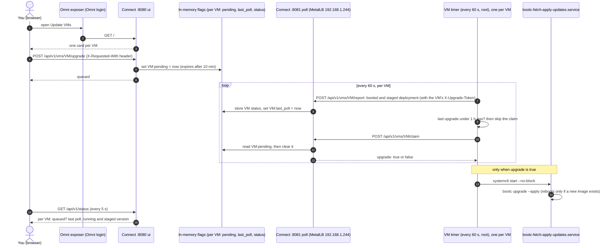
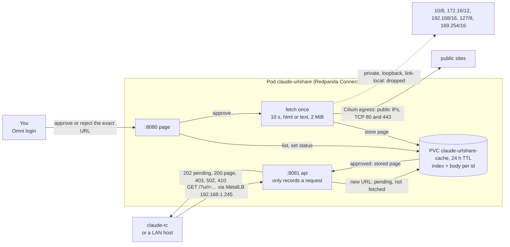
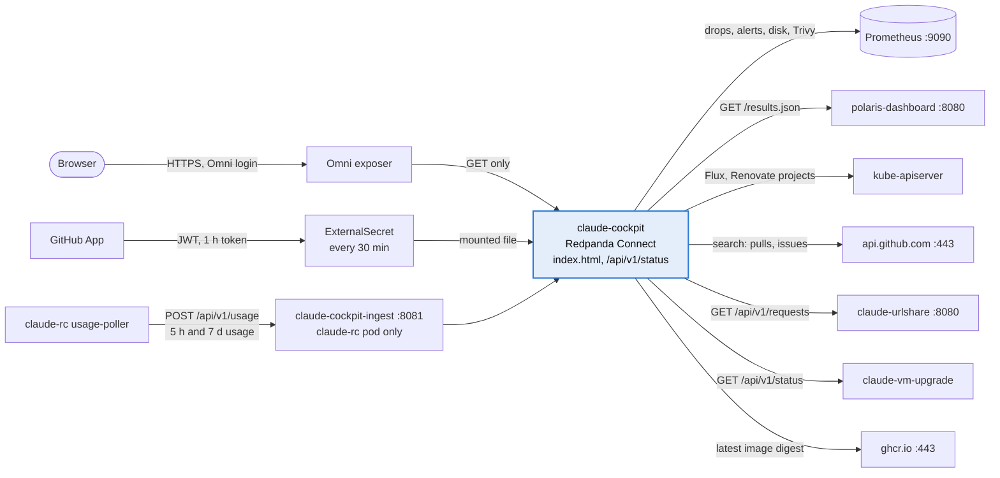

# claude-system

Claude Code **Remote Control** with read-only cluster access and an egress whitelist. The pod runs
`claude remote-control` under your own claude.ai login (stored on a PVC), so the session appears at
claude.ai/code. No admin settings or environment key are needed. Docs: <https://code.claude.com/docs/en/remote-control>.

| File | What |
|---|---|
| `rbac.yaml` | ServiceAccount `claude`; built-in `view` (no Secrets) plus read-only access to nodes, storage, CRDs and the CRD groups in use (including MetalLB, the ARC runner resources, the trivy-operator reports, External Secrets and the Renovate operator). No write verbs, no `pods/exec` |
| `clusterrole-elevated.yaml` | The break-glass ClusterRoles `claude-ops`, `claude-debug` and `claude-storage`; nothing binds them by default |
| `elevate/` | The "Elevate Claude" page (below): a Redpanda Connect pod, its RBAC, limits and admission policies |
| `jobs/` | The "Run jobs" page (below): a Redpanda Connect pod with its own ServiceAccount, RBAC and admission policy |
| `prometheusrule.yaml` | The recorded expiry date of the Omni service account key as a Prometheus series, and the warning (30 days) and critical (7 days) alerts on it |
| `networkpolicy.yaml` | Cilium default deny, then DNS, the Kubernetes API and TCP 443 to the hosts Claude Code needs |
| `githubaccesstoken.yaml` | External Secrets `GithubAccessToken` generator |
| `externalsecret.yaml` | ExternalSecret that writes the one-hour GitHub App installation token into `claude-github-token` every 30 minutes |
| `deployment.yaml` | `claude-rc`: idles until a login exists, then runs `claude remote-control`; non-root, read-only root filesystem |
| `claude-md/CLAUDE.md` | The only `CLAUDE.md` (user-level and repo notes together), generated into the `claude-md` ConfigMap by `kustomization.yaml` and symlinked to `~/.claude/CLAUDE.md` at pod start. Edit it in Git; the ConfigMap name hash rolls the pod |
| `claude-md/skills/<name>/SKILL.md` | Task-specific runbooks split out of `CLAUDE.md`, generated into the `claude-skills` ConfigMap and mounted at `/etc/claude-skills` (items map each key to `<name>/SKILL.md`); copied into `~/.claude/skills/` at pod start |
| `usage/` | Usage page and JSON API out: `deployment.yaml`, `service.yaml`, and `podmonitor.yaml` for the Redpanda Connect; `redpanda-connect.yaml` (PromQL behind each endpoint), `index.html` (the page) |
| `trivy/` | Trivy vulnerabilities page and JSON API out: `deployment.yaml`, `service.yaml`, `podmonitor.yaml`; `redpanda-connect.yaml` (PromQL behind each endpoint), `index.html` (the page) |
| `vm-upgrade/` | "Update VMs" buttons (claude-vm and homeserver): `deployment.yaml`, `service.yaml`, and `podmonitor.yaml`; `redpanda-connect.yaml` (a flag per VM, two listeners), `index.html` (the page) |
| `cockpit/` | The cockpit status page (below): `deployment.yaml`, `service.yaml`, `podmonitor.yaml` and `rbac.yaml`; `redpanda-connect.yaml` (one read-only status call, a branch per source), `index.html` (the page) |
| `urlshare/` | Approval-gated URL sharing: `deployment.yaml`, `service.yaml`, and `podmonitor.yaml`; `redpanda-connect.yaml` (requests, fetch, TTL, clear cache), `index.html` (the approval page) |
| `pvc.yaml` | `claude-home-lvm` (10Gi) holds the login (`/home/claude`); delete it to sign out. `claude-workspace-lvm` (50Gi) is `/workspace`. `claude-urlshare-cache` (1Gi, `lvm-bulk`) holds the `claude-urlshare` request index and stored pages |
| `../../../images/claude-runner/` | Image: Anthropic publishes none, so this wraps the `claude` binary (checksum verified) plus `kubectl`, `gh`, `crane`, `talosctl`, `omnictl`, the Flux MCP server and a git credential helper |

## 1. Build the image

A merge that changes `images/claude-runner/**`, the weekly rebuild or a manual run of **Build and release the Claude runner image** publishes
`ghcr.io/cthtrifork/talos-gitops/claude-runner:<Claude Code version>-<date>.<run>` and a release `claude-<that tag>`. Put that tag, pinned by digest,
in `deployment.yaml`. Renovate bumps `CLAUDE_CODE_VERSION` in the Dockerfile; the checksum is read from the release manifest at build time
(checksum: `https://downloads.claude.ai/claude-code-releases/<version>/manifest.json`, `linux-x64`).

## 2. GitHub access for git

The pod reads a token from the Secret `claude-github-token` and hands it to git for `github.com` only
(the image's `gh` wrapper reads the same file, so the pod can push branches and open PRs; `api.github.com` is in the egress allowlist). A GitHub App keeps that Secret
fresh, with a token that expires every hour.

`githubaccesstoken.yaml` has External Secrets sign a JWT with the App's private key and exchange it for a
one-hour installation token, with everything the App was granted on the repositories it is installed on (the request is not narrowed,
so scope it in the App's settings). `externalsecret.yaml` writes that short-lived token to the Secret mounted by the pod.

1. Create the App (GitHub: Settings > Developer settings > GitHub Apps > New). Repository permissions:
   **Contents: read and write**, **Pull requests: read and write**, **Workflows: read and write**,
   **Metadata: read**. Leave everything else off. **Workflows** lets the App push changes under
   `.github/workflows/`; turn it off in the App's settings to forbid that. Untick "Webhook active". Never make it a bypass actor in a ruleset.
2. Generate a private key (downloads a `.pem`), install the App only on the repositories Claude should reach, and note the
   **App ID** (App settings page) and the **installation ID** (the number at the end of the installation's
   URL, `https://github.com/settings/installations/<id>`).
3. Create the credentials Secret `claude-github-app` as a SOPS-encrypted file (command and key rotation: "Secrets (SOPS)" in the root `readme.md`).

4. The first token is created when External Secrets syncs (within a minute of the apps reconciling). Check it:

```sh
kubectl -n claude-system get externalsecret claude-github-token   # STATUS SecretSynced, READY True
kubectl -n claude-system get secret claude-github-token
```

If it is not ready, `kubectl -n claude-system describe externalsecret claude-github-token` shows the error (a wrong App ID,
installation ID or key, or api.github.com blocked: see the `cilium-drops` skill). Git pushes fail until the Secret exists (the pod itself starts without it).

### Pull token for private images (optional)

`crane` in the pod reads private ghcr.io packages through a Docker config from the Secret `ghcr-pull`, mounted at
`/etc/registry-auth/config.json` with `DOCKER_CONFIG=/etc/registry-auth`. Create it as a SOPS-encrypted file (command and rotation: "Secrets (SOPS)" in the root `readme.md`) from a token that has
**only `read:packages`**, so the pod can read but never push (the pod starts without it).

## 3. Sign in once

The pod idles and logs "not logged in" until a login exists:

```sh
kubectl -n claude-system exec -it deploy/claude-rc -- claude
```

Run `/login`, open the URL on your own machine, paste the code back, then `/exit`. Within 30 seconds the
pod starts `claude remote-control` and the session appears at <https://claude.ai/code>. The login and
its token refreshes stay on the PVC, so restarts need no new login. To sign out, delete the
`claude-home-lvm` PVC. The PVC holds your login: anyone with node access can act as you.

## Flux MCP server

The image carries `flux-operator-mcp` (<https://fluxcd.control-plane.io/mcp/>). The deployment registers it as the
user-scoped MCP server `flux` at every start, in read-only mode (`--read-only`: no reconcile, suspend, resume or
apply tools). It uses the pod's in-cluster ServiceAccount, so it can read no more than `rbac.yaml` allows. Check
with `claude mcp list` in the pod. No egress change is needed, it only talks to the Kubernetes API.

## Cloudflare MCP server

The deployment registers Cloudflare's API MCP server (`https://mcp.cloudflare.com/mcp`, see
<https://developers.cloudflare.com/agents/model-context-protocol/mcp-servers-for-cloudflare/>) as the user-scoped MCP server
`cloudflare` at every start, when the Secret `claude-cloudflare` exists. It authenticates with the key `CLOUDFLARE_API_TOKEN` as a
bearer token. Read-only is enforced by the token, not by the MCP server (which can also make changes): create it with Read
permissions only (for example Zone:Read, DNS:Read, Analytics:Read), scoped to the account or zones to expose, never Edit.

The Secret is SOPS-encrypted (root `readme.md`). The header holds the literal `${CLOUDFLARE_API_TOKEN}`, which Claude Code
expands when it connects, so the token is not written to `~/.claude.json` on the PVC. To rotate, edit the Secret with `sops edit`
and restart the pod. Egress: `mcp.cloudflare.com` only. Check with `claude mcp list` in the pod.

## talosctl (read-only, through Omni)

The image carries `talosctl` and `omnictl`. The Talos API is reached through Omni, so the credential is an Omni service account with
the **Reader** role, not a Talos client certificate. If the Secret `omni-service-account` exists, the deployment passes `OMNI_ENDPOINT`
and `OMNI_SERVICE_ACCOUNT_KEY` to the pod and runs `omnictl talosconfig` at every start to write `$TALOSCONFIG`
(`/home/claude/.talos/config`); `talosctl` reads the key from the environment. Egress: the Omni endpoint only. Check in the pod:

```sh
talosctl -n <node-ip> get links     # works
talosctl -n <node-ip> reboot        # PermissionDenied
```

**Create** the service account on your machine with `omnictl serviceaccount create claude-rc --role Reader --use-user-role=false --ttl 8760h`
(the key is shown once), then store it in `omni-service-account.enc.yaml` as the keys `OMNI_SERVICE_ACCOUNT_KEY` and `OMNI_ENDPOINT` ("Secrets (SOPS)" in the root `readme.md`).
**Renew** before the key expires (TTL 365 days; `prometheusrule.yaml` alerts 30 and 7 days before the date recorded there, so
update that date to the new expiry in the same PR): `omnictl serviceaccount renew claude-rc --ttl 8760h`, put the new key in the Secret and merge. Reloader
(or a manual restart) rolls the pod. The pod then holds a credential for the node-management plane next to the claude.ai login and
the GitHub token, and node files and logs read with `talosctl` are input Claude acts on, so keep the role at Reader.

## Check what the pod can and cannot do

```sh
SA=system:serviceaccount:claude-system:claude
kubectl auth can-i list pods -A --as=$SA                          # yes
kubectl auth can-i list clusters.postgresql.cnpg.io -A --as=$SA   # yes
kubectl auth can-i get secrets -A --as=$SA                        # no
kubectl auth can-i delete pods -A --as=$SA                        # no
kubectl auth can-i create pods/exec -A --as=$SA                   # no
```

Anything the pod reads from the cluster (logs, events, annotations) is input Claude acts on, so keep
the App installed only on the repositories Claude needs and its permissions minimal; the token is not narrowed beyond that. The `claude` ServiceAccount cannot read Secrets through the
API, but the GitHub token and your claude.ai login are in this pod, so treat the pod as holding both.

## Usage telemetry

Claude Code exports OpenTelemetry metrics (tokens, cost, sessions, lines of code, commits, pull requests, active time) from
`claude-rc` and from the Claude VM ([homeserver-bootc](https://github.com/cthtrifork/homeserver-bootc)) straight into the
cluster Prometheus, through its OTLP receiver (`enableOTLPReceiver` in `k8s/infra/kube-prometheus-stack/helm-release.yaml`).
Both send `environment=<name>` as a resource attribute (`claude-k8s-helper`, `claude-vm`), which is promoted to a label.

Both senders set exactly these variables (`claude-rc` in `deployment.yaml`, the VM in homeserver-bootc `managed-settings.json`);
only the endpoint and the environment name differ:

| Variable | Value | Why |
|---|---|---|
| `CLAUDE_CODE_ENABLE_TELEMETRY` | `1` | switches the exporter on; independent of `DISABLE_TELEMETRY=1` (Datadog and error reporting) |
| `OTEL_METRICS_EXPORTER` | `otlp` | |
| `OTEL_EXPORTER_OTLP_PROTOCOL` | `http/protobuf` | what Prometheus' receiver takes |
| `OTEL_EXPORTER_OTLP_ENDPOINT` | VM: `http://otel.portableinfo.cloud/api/v1/otlp`; `claude-rc`: `http://kube-prom-prometheus.kube-prometheus-stack-system.svc:9090/api/v1/otlp` | Claude Code appends `/v1/metrics`; the pod stays inside the cluster, so its telemetry does not depend on Cloudflare DNS or the load balancer address |
| `OTEL_EXPORTER_OTLP_METRICS_TEMPORALITY_PREFERENCE` | `delta` | the default is cumulative, and with `session_id` off several `claude` processes (the VM has several sessions and two users) would write the same series with different totals; deltas add up |
| `OTEL_RESOURCE_ATTRIBUTES` | `environment=claude-k8s-helper` / `claude-vm` | promoted to a label |
| `OTEL_METRICS_INCLUDE_SESSION_ID` | `false` | see the labels note below |
| `OTEL_METRICS_INCLUDE_ACCOUNT_UUID` | `false` | constant, so no use as a label |

- **Receiver:** `otel.portableinfo.cloud` is a Cloudflare A record `otel` -> `192.168.1.243` (DNS only): the MetalLB address of
  `prometheus-otlp-lb`, plain HTTP on 80, because the VM's egress gateway forwards HTTP by `Host`. LAN only, no ingress, no
  authentication; the same Service reaches the whole Prometheus HTTP API (the admin API is off). `claude-rc` uses the in-cluster
  service instead (its policy allows Prometheus on 9090).
- **Delta counters:** `otlp-deltatocumulative` adds them up in memory, so a Prometheus restart starts the counters at 0
  (`increase()` copes with that).
- **Names:** `otlp.translationStrategy: UnderscoreEscapingWithoutSuffixes` gives `claude_code_token_usage{environment,model,type}`,
  `claude_code_cost_usage{environment,model}` (USD), and `claude_code_session_count`, `claude_code_lines_of_code_count{type}`,
  `claude_code_commit_count`, `claude_code_pull_request_count`, `claude_code_active_time_total` (seconds), all with `environment`.
  Example, USD per day: `sum by (environment,model)(increase(claude_code_cost_usage[1d]))`.
- **Retention:** 30 days on a 20Gi volume (`retentionSize` 16GiB). To afford it, histogram buckets are dropped from the apiserver,
  kubelet and Dependency-Track scrapes (they were 104k of 193k series); `_sum` and `_count` stay, percentiles of those are gone.
  The volume is a real 20Gi `lvm-fast` volume (expandable online); watch the `openebs-lvm-alerts` for the volume group.
- Claude Code sends its attributes on every datapoint and Prometheus keeps them all as labels: besides `environment`, `model` and
  `type` also `user_email`, `user_id`, `organization_id`, `terminal_type`, `effort` and `query_source`. They are kept: with one or two
  users they cost nothing, and they allow a per-user split. `session_id` and `user_account_uuid` are switched off with
  `OTEL_METRICS_INCLUDE_SESSION_ID=false` and `OTEL_METRICS_INCLUDE_ACCOUNT_UUID=false`, for accuracy rather than size: every session
  would be its own cumulative series, `increase()` cannot see the first export of a series, and a session that exports once or twice
  would count as zero.
  The usage API always sums by `environment`, so it is unaffected by the extra labels.

### Usage page and API

`usage/deployment.yaml` deploys a Redpanda Connect that holds no data: every request becomes PromQL against Prometheus.
It is exposed through the Omni service exposer (`omni-kube-service-exposer.sidero.dev/*` on `Service/claude-usage`, port
50091, plain HTTP, LAN only, read-only, aggregates only).

| Request | Answer |
|---|---|
| `GET /` | the page (`usage/index.html`: totals, per-day columns by environment, cost and token mix by model, tables) |
| `GET /api/v1/summary` | today (since 00:00 UTC), 7d and 30d: total and per environment |
| `GET /api/v1/daily?days=30` | cost, tokens, sessions, commits and pull requests per UTC day and environment (2-90 days, today included) |
| `GET /api/v1/breakdown?window=7d` | tokens, cost and lines changed per environment and model (`today`, `7d`, `30d`) |
| `GET /api/v1/decisions?window=7d` | edit tool decisions per environment, tool, decision, language and source (top 50) |
| `GET /healthz` | `ok` |

A failed Prometheus query answers `502`. Query parameters are clamped numbers or picked from a list, never PromQL text.
Only series Prometheus holds are shown. Tokens, cost and lines have a `model` label; sessions, commits, pull requests and active
time do not, so they are per environment only (and so is cost per commit). The page script is plain JavaScript with no external assets; the numbers are `increase()` over
the window, so the very first export of a new model or environment is not counted.
From `claude-rc`: `curl -s http://claude-usage.claude-system.svc/api/v1/summary`.

### Trivy vulnerabilities page and API

`trivy/` is the same pattern as `usage/`: a Redpanda Connect that holds no data and answers each request with PromQL against Prometheus (`Service/claude-trivy`, port 50099, prefix `claudetrivy`, LAN only, read-only).

| Request | Answer |
|---|---|
| `GET /` | the page (`trivy/index.html`: findings per image, critical and high vulnerabilities) |
| `GET /api/v1/images` | `trivy_image_vulnerabilities` per namespace, image digest and severity, plus the scan age per image |
| `GET /api/v1/vulnerabilities` | critical and high `trivy_vulnerability_id` with title, score and the number of images they are found in |
| `GET /healthz` | `ok` |

Scan age is `time() - kube_customresource_vulnerabilityreport_created` (kube-state-metrics custom resource state, `k8s/infra/kube-prometheus-stack/`), joined to the trivy series on namespace and report name: the operator recreates the report on every rescan.
Every query takes the `max` or `count` per image digest, because the operator can run twice during a rollout and exports one series per container. A failed query answers `502`.
From `claude-rc`: `curl -s http://claude-trivy.claude-system.svc/api/v1/images`.

## Update VMs buttons

`vm-upgrade/` holds a Redpanda Connect with one in-memory flag per VM (`claude-vm`, `homeserver`) and two listeners. Each VM polls its flag and
runs `bootc upgrade --apply` itself (units in [homeserver-bootc](https://github.com/cthtrifork/homeserver-bootc)); the cluster never connects to
a VM and never sends it a command. The page also shows the digest of each VM's latest image in `ghcr.io` (cached 5 minutes, read with the `ghcr-pull`
read:packages token like the cockpit page, egress to `ghcr.io` only) and marks a VM "Update available" when it runs an older one; without the Secret
the Latest row says "unknown".



| Listener | Reached through | Endpoints |
|---|---|---|
| `:8080` page | Omni service exposer, `Service/claude-vm-upgrade` (port 50092, behind Omni login) | `GET /` the page, `GET /api/v1/status`, `POST /api/v1/vms/<vm>/upgrade` (needs the header `X-Requested-With: vm-upgrade-button`, so a form on another site cannot post it) |
| `:8081` poll | MetalLB `claude-vm-upgrade-lb`, 192.168.1.244, plain HTTP; every request needs the `X-Upgrade-Token` of the VM in the path | `POST /api/v1/vms/<vm>/report`: the VM's booted and staged ostree deployment (also counts as a poll); `POST /api/v1/vms/<vm>/claim`: answers `{"upgrade": true}` once per click, then clears the flag |

`<vm>` is `claude-vm` or `homeserver` (the list is `vm_names` in `redpanda-connect.yaml`); anything else is a 404. A third VM needs its name there, two more lines in
the `/api/v1/status` handler, its pod selector in `CiliumNetworkPolicy/claude-vm-upgrade` (ingress and egress), a label in `index.html`, a token (a `Password`
generator and `PushSecret` in `k8s/infra/secret-store/`, three `ExternalSecret`s in `vm-upgrade/externalsecret.yaml`, an env var in `deployment.yaml`), and the
injection rule in the VM's egress policy.

The flag lives 10 minutes and is cleared by the first claim, so one click is at most one upgrade; a pod restart drops an unclaimed click.
The poll listener has no way to queue an upgrade, and the page listener has no `claim`.

### Access and DNS

Each VM has its own token (`claude-vm-upgrade-token`, `homeserver-vm-upgrade-token`), generated in `secret-store`. An ExternalSecret in the VM's namespace
(`vm-upgrade-token`) copies it, and `virtualmachine.yaml` shares that Secret into the guest over virtiofs (feature gate `EnableVirtioFsConfigVolumes`, tag
`upgrade-token`). The guest mounts it (`mount -t virtiofs upgrade-token <dir>`, an `/etc/fstab` line) and the poll scripts send the `token` file as `X-Upgrade-Token`.
The listener answers 401 unless the header equals the token of the VM in the path (and 401 for every VM when its token is unset), so a VM can only claim and report
for itself, and a LAN host, a node's host-network process or a pod that is not a VM has no token. The `/healthz` path is open. Cilium does not inject the header:
an L7 rule on a LoadBalancer address backed by a pod sends the pod's replies around Envoy, and the VM resets them.

Ingress lets in the two VM pods and, for traffic source-NATed to the node the VM runs on, `host` and `remote-node` (`CiliumNetworkPolicy/claude-vm-upgrade`);
the token, not the source address, is the authentication. Limits: the poll is plain HTTP, so a host in the path could answer `{"upgrade": true}` (bounded by each
VM's one-upgrade-per-hour limit); the token is readable by root in its VM; it is compared with `==`, not in constant time. Rotating a token: delete the key in the
`secret-store` namespace Secret; External Secrets regenerates it, Reloader restarts the listener, and the VM's file follows within kubelet's sync delay (about a
minute) with no VM restart. Polls fail with 401 until both sides have the new value.

The VMs resolve `vm-upgrade.portableinfo.cloud` through the router (`dnsConfig` in `virtualmachine.yaml`), and both images poll `http://vm-upgrade.portableinfo.cloud`,
hardcoded. The one manual step is the Cloudflare record (DNS only, like `otel.portableinfo.cloud`): an `A` record `vm-upgrade` -> `192.168.1.244`. Until it exists the
VMs log that the page is unreachable and try again a minute later. The name is in both images (`poll-upgrade` and `vm-upgrade-poll`); changing it means rebuilding them.

Check from a VM: `curl -s -XPOST http://vm-upgrade.portableinfo.cloud/api/v1/vms/claude-vm/claim` answers `{"upgrade":false}` while nothing is queued. From any
other address it answers 401. To confirm the injection, request the claim path of the other VM from a VM: 401.

The page shows, per VM, when it last polled and what it runs (booted version and image digest, and the staged version if any), so a dead timer is
visible and you can tell whether an update is waiting for a reboot.

The report is deliberately dumb: the VM reads `rpm-ostree status --json` (local ostree data, no registry call) and sends three strings. Connect keeps
only those fields, with plain characters and at most 64 of them, and the page shows them as text. It does not say whether a newer image exists: that
needs a registry request, which the VM does not make for the page. A spoofed report could only change what the page displays.

### Elevate Claude (break-glass page)

A page behind the Omni exposer (`Service/claude-elevate`, port 50094): pick a tier, namespaces and a time, and Claude gets a short-lived token for
that tier there, as `/etc/elevated/<tier>-<namespace>.kubeconfig` (a Secret mount the kubelet refreshes within about a minute, so no restart: the
Secret has no Reloader annotation, a restart would end the session; use it with `kubectl --kubeconfig`). One Redpanda Connect container calls the
Kubernetes API with the pod's own token; the routes and steps are in the pipeline, `elevate/redpanda-connect.yaml`.

| Tier | Role | Max | Grants |
|---|---|---|---|
| `ops` | `claude-ops` | up to 60 min | delete or evict pods, delete StatefulSets (to recreate their PVCs), delete Trivy `vulnerabilityreports` and `sbomreports` (to force a rescan) |
| `debug` | `claude-debug` | up to 15 min | `pods/exec`, `pods/portforward`, `pods/ephemeralcontainers` |
| `flux` | `claude-flux` | up to 15 min | ask Flux to reconcile a HelmRelease or Kustomization (`reconcile.fluxcd.io/requestedAt`, `forceAt`, `resetAt` annotations only; the admission policy `claude-flux-reconcile-only` rejects any other change) |
| `storage` | `claude-storage` | up to 15 min | delete PersistentVolumeClaims (both storage classes reclaim with `Delete`: a bound claim loses its data), CloudNativePG `Cluster`s and CDI `DataVolume`s (so Flux recreates them) |

- **Opt-in.** A namespace opts in per tier with the label `claude-elevate/<tier>: "true"` in its own manifest (`grep -r claude-elevate/ k8s`). `debug` is only
  set in `adguard-system` (exec elsewhere could read secrets), and `external-dns-system` has `ops` only, since exec there could read the DNS API token.
  `flux-system` is managed by the flux-operator, so its labels (`ops`, `flux`) come from a patch in the `FluxInstance`.
- **Expiry.** The token expires on the API server by itself and nothing cleans up afterwards: the ServiceAccount, RoleBinding and kubeconfig key left
  behind hold no valid token, and the next grant replaces them. A revoke deletes the ServiceAccount, which kills its tokens at once.
- **Limits.** The API server validates. RBAC pins the pod to the four roles and to `claude-elevate-<tier>` objects;
  `claude-elevator-rolebindings` allows only that ServiceAccount, only in an opted-in namespace; `claude-elevator-tokens` caps a token at the tier's
  minutes in `ConfigMap/claude-elevate-limits` (the page reads it too). The page container holds a credential that can grant, bounded by these.
- **Reach.** Only the Omni exposer, the cockpit (page port, to list the active grants; it drops the csrf value) and Prometheus (metrics port) reach the pod, never `claude-rc`. A POST must carry the `csrf` value from the status
  (a hash of the pod's token, which a page on another site cannot read; a header would not do, Connect copies query parameters into the same metadata),
  and requests are handled one at a time.
- **Not offered.** Patching workloads (rollout restarts) and any Flux change beyond the reconcile annotations. `debug` reads whatever a pod in the namespace can
  (mounted Secrets, its ServiceAccount token).
- **Token storage and audit.** The token is plain text in the Secret (readable with `get secrets` in `claude-system`) and in the mount. Grants and
  revokes are log lines on the container (no log shipper: `kubectl logs`) and count in `elevate_requests{action,tier}`; who clicked is not recorded.

### Run jobs (CronJobs now)

A page behind the Omni exposer (`Service/claude-jobs`, port 50098), in its own pod so that the elevator keeps no `jobs` rights. It lists the CronJobs of
the opted-in namespaces with their schedule, time zone, next run (computed in the browser with Croner; Kubernetes reports none) and last run, and runs
one now (`POST /api/v1/jobs`), the way `kubectl create job --from=cronjob/<name>` does. The pod creates the Job from the CronJob's own template and
owner reference; Claude's tokens get no `jobs` rights. Routes and steps: `jobs/redpanda-connect.yaml`.

- **Opt-in.** Only namespaces labelled `claude-jobs/run: "true"` (`dependency-track-system`, `trivy-system`); the page shows each CronJob's one-line description from its
  annotation `claude-jobs/description` (add it to every CronJob in such a namespace).
- **Limits.** `ServiceAccount/claude-job-runner` can list namespaces, CronJobs and Jobs (a CronJob counts as running while a Job it owns is unfinished, manual ones included), get a CronJob and create Jobs, nothing else. The admission policy
  `claude-job-runner` allows a Job only in an opted-in namespace, with the manual annotation, one CronJob owner. The policy cannot compare the pod spec
  with the CronJob's, so the pod's token (`create jobs` cluster-wide, gated by that label) is the trust boundary.
- **Reach.** Only the Omni exposer, the cockpit (page port, read-only status; it drops the csrf value) and Prometheus (metrics port) reach the pod, never
  `claude-rc`. A POST must carry the `csrf` value from the status, as on the Elevate page. Starts are log lines and count in `jobs_requests{action}`.

## Share URLs (approval-gated page fetch)

`urlshare/` lets Claude read an article without a wider egress allowlist. Claude asks, the owner approves the exact URL, the pod fetches it once.



A request is `pending` until you decide, then `approved`, `failed` (approve again to retry) or `rejected`. Every state is forgotten after 24 h, or at once with the page's **Clear cache** button (a card that shows how many pages and KiB are stored; the button asks a second time on the page, no browser dialog, and goes back after 8 seconds if you do nothing).

| Listener | Reached through | Endpoints |
|---|---|---|
| `:8081` api | MetalLB `claude-urlshare-lb`, 192.168.1.245, plain HTTP, only from `claude-rc` and 192.168.1.0/24 | `GET /?url=<URL-encoded URL>` (or `/<id>`): `200` the stored page, `202` pending (nothing fetched), `403` rejected, `502` fetch failed (`error` says why), `410` expired, `400` not an acceptable URL, `429` too many waiting |
| `:8080` page | Omni service exposer, `Service/claude-urlshare` (port 50096, behind Omni login) | `GET /` the page, `GET /api/v1/requests`, `POST /api/v1/requests/<id>/approve\|reject`, `POST /api/v1/cache/clear` (deletes every stored page and the request list; both POSTs need `X-Requested-With: urlshare-approval`) |

- **Flow:** an unknown URL becomes `pending` and is not fetched. Approving fetches it (10 s timeout, redirects followed) and stores the HTML or plain
  text. Requests, decisions and pages live 24 h on the 1Gi `lvm-bulk` `claude-urlshare-cache` PVC (`pvc.yaml`, at most 100 requests), so they survive a restart.
  The file cache has no expiry of its own: the app deletes the page of each expired request, and a page whose request is no longer in the list
  (a crash between the two writes) is not cleaned up. Delete the PVC to wipe everything.
- **Where it can fetch from** is decided by `CiliumNetworkPolicy/claude-urlshare`, not by the app (Redpanda Connect cannot inspect the address it
  connects to): TCP 80 and 443 to addresses outside the private, loopback, link-local and other special ranges, so a name that resolves to
  one, or a redirect to one, is dropped and the fetch fails. The app also refuses non-http(s) URLs, other ports, user names, IP literals and
  names such as `*.local`, and keeps only `text/html`, `application/xhtml+xml` and `text/plain`. Nothing is executed; pages are served with
  `Content-Security-Policy: sandbox` and `nosniff`.
- **Limits that are weaker than they look:** the 2 MiB size limit is checked after the download (Connect has no download limit), so a larger
  page is only bounded by the 10 s timeout and the 384Mi memory limit, and a fetch holds up other requests until it ends (one pipeline
  thread, so the list of requests is never written twice at once). The approval page has no login of its own: it is the Omni exposer's.
- **Manual step:** a Cloudflare `A` record `urlshare` -> `192.168.1.245` (DNS only, like `vm-upgrade`). Inside the cluster
  `http://claude-urlshare-lb.claude-system.svc/` works without it.

## Cockpit

Status page for the cluster, GitHub and the homelab (issue #849), behind the Omni login (`Service/claude-cockpit`, port 50097). A Redpanda Connect pod:
`GET /api/v1/status` reads every source in parallel, one branch each, so a source that is down only leaves its own panel out. It sends only GETs and keeps
no state except the usage value pushed by `claude-rc`.

Redpanda Connect is reused rather than a new runtime: the other pages here already run it, it queries Prometheus (`usage/`) and calls the Kubernetes API (`elevate/`), and a status page is a few HTTP reads with a small mapping each. Nothing extra to build, scan or keep pinned.



| Panel | Source |
|---|---|
| Dropped traffic, firing alerts, disk | Prometheus (`hubble_drop_total`, `/api/v1/alerts`, `node_filesystem_*`). The Omni key, certificate and ExternalSecret alerts show under alerts |
| Flux, Renovate runs | Kubernetes API (`claude-cockpit` ClusterRole: get and list on Kustomizations, HelmReleases and RenovateProjects) |
| Polaris score | `polaris-dashboard` `/results.json` |
| Trivy vulnerabilities | Prometheus, from the trivy-operator metrics (`trivy_image_vulnerabilities` for the counts per severity and the worst images, `trivy_vulnerability_id` for the critical findings with CVSS score and fixed version). The operator exports one series per container, so the queries take the `max` per `image_digest` first and an image run by several pods is counted once. Findings are per package, so one CVE in three packages counts three times. Critical is red, high amber, the rest only counted |
| Pull requests, issues | GitHub search over all repositories of the owner the App is installed on (private ones included), with the cockpit's own one-hour read-only App token (`githubaccesstoken.yaml`, `externalsecret.yaml`) |
| Running versions | `claude-vm-upgrade` `GET /api/v1/status`, compared with the digest of each VM's `latest` image in `ghcr.io`, read with the runner's `ghcr-pull` read:packages token (`homeserver-bootc` is a private package) |
| Share URLs | `claude-urlshare` `GET /api/v1/requests` on the approval listener (read-only, never the page content): what waits for approval and what was decided in the last 24 hours. `CiliumNetworkPolicy/claude-urlshare` lets the cockpit pod in on `:8080` |
| Elevate Claude | `claude-elevate` `GET /api/v1/status` on the page listener: the active grants (tier, namespace, expiry), nothing else; the status's csrf value is dropped in the mapping. `CiliumNetworkPolicy/claude-elevate` lets the cockpit pod in on `:8080` |
| Scheduled jobs | `claude-jobs` `GET /api/v1/status` on the page listener: namespace, name, schedule, time zone, suspended, last run; the csrf value is dropped in the mapping. The next run is computed in the page. `CiliumNetworkPolicy/claude-jobs` lets the cockpit pod in on `:8080` |
| Claude usage | Pushed every 5 minutes by the `usage-poller` container of `claude-rc` (see "Claude usage from the pod") to `POST /api/v1/usage` on `:8081`, one value kept in memory for 24 hours |

The `:8081` listener has no token, like `vm-upgrade`: `CiliumNetworkPolicy/claude-cockpit` lets in the `app=claude-rc` pod only, through the ClusterIP Service
`claude-cockpit-ingest`, so a spoofed sender could only change what the page shows.

### On the iPhone Home Screen (cockpit and share URLs pages)

The page is made for Safari's "Add to Home Screen": it opens full screen (`apple-mobile-web-app-capable`), has an inline 180 px touch icon, keeps clear of
the notch and home indicator (`viewport-fit=cover` and `env(safe-area-inset-*)`), uses 44 px touch targets and no hover-only styles, and refreshes on resume
and on a pull down from the top (there is no reload button in a Home Screen app). There is no manifest and no service worker: the page is behind the Omni
login, and neither request would carry its cookies, so the icon is a data URI and the page needs the network. After changing the icon, remove the Home Screen
entry and add it again; iOS caches it.

### Claude usage from the pod

`claude remote-control` is a server without a terminal UI, so its sessions never run a `statusLine`. The `usage-poller` container of
`claude-rc` instead asks `GET https://api.anthropic.com/api/oauth/usage`, the endpoint behind Claude Code's `/usage`, every 5 minutes (`POLL_INTERVAL`)
with the login on `claude-home`, mounted read-only. It posts the two windows (percentage and reset time in epoch seconds) to
`http://claude-cockpit-ingest.claude-system.svc:8081/api/v1/usage`. The script comes from the
`claude-usage-poller` ConfigMap and only logs when a poll fails. `CiliumNetworkPolicy/claude-cockpit` lets only `app=claude-rc` in on `:8081`.

Caveats: the endpoint is undocumented (its `anthropic-beta` header is an internal detail) and can change. A long-lived `claude setup-token` token answers
403 there (tested), so only the login can be used. The poller never refreshes the token: Claude Code does that in place, so while the login is expired the
poll logs `usage endpoint answered 401` and the panel goes stale after 6 hours. Check with `kubectl -n claude-system logs deploy/claude-rc -c usage-poller`.

Check after Flux applied it:

```sh
kubectl -n claude-system get pods -l app=claude-cockpit
kubectl -n claude-system logs deploy/claude-rc -c usage-poller --tail=3                 # "posted" every 5 minutes
kubectl -n claude-system port-forward deploy/claude-cockpit 8080:8080                # needs the debug tier
curl -s localhost:8080/api/v1/status | jq 'keys, .meta'                               # meta.workflow.failed names a source that did not answer
```
