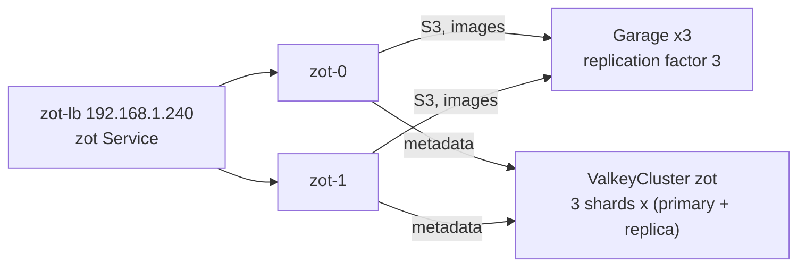

# zot registry

zot is the pull-through cache and CI registry of the cluster (`docs/registry-mirrors.md`). It runs as 2 replicas on different
nodes. The replicas hold no data: the images are in Garage and the metadata is in Valkey, both shared.



| Part | Where |
|---|---|
| zot (HelmRelease, config `zot.json`, Services) | here |
| Garage, the object store | `../garage/` |
| `ValkeyCluster/zot` | `../valkey/valkeycluster.yaml` |
| The Valkey operator | `k8s/infra/controllers/valkey-operator-system/` (must watch `registry-system`) |
| Secrets `garage-secrets`, `garage-s3-key` | External Secrets from `secret-store` (`zot-garage-*`) |
| Network policies | `../networkpolicy.yaml` |

## Things to know

- **Not zot's scale-out `cluster` mode, on purpose.** Both replicas serve every repository, so a node can be in maintenance
  without any repository becoming unavailable (cluster mode makes a down replica's repositories unavailable). A single replica
  would not survive a drain either, because its `lvm-fast` volume is pinned to a node.
- **Known race.** zot's store lock is per process, so two replicas updating the same repository at the same time can overwrite
  each other's `index.json` and lose a tag. In the cache repositories that is a later cache miss. A direct push to `pr/**` or
  `buildcache/**` has to be rerun. The ARC runners fall back to the origin registry if zot is unavailable.
- **`downloadDir`**: the sync extension needs a local staging directory with S3 storage. It is on the zot volume.
- **The zot volume** is `20Gi` and only holds the root directory and the sync staging area. `volumeClaimTemplates` are immutable, so
  changing `pvc.storage` fails the Helm upgrade (`docs/helmrelease-conventions.md`): delete the StatefulSet's claims and recreate the release.
- **Valkey keys** start with the hash tag `{zot}` (`keyprefix` in `zot.json`). Do not remove the braces (see `valkeycluster.yaml`).
- **The `garage-layout` Job** assigns the nodes and creates the bucket and key. Delete it to run it again.

## Draining a node

`lvm-fast` volumes are pinned to their node, so a zot, Garage or Valkey pod evicted from a cordoned node stays `Pending` until the
node is back. A node can hold two Valkey pods, and the operator's PodDisruptionBudget allows one down at a time, so a normal
`kubectl drain` waits for a pod that cannot recover. Skip the eviction API for one node at a time:

```sh
kubectl drain <node> --ignore-daemonsets --delete-emptydir-data --disable-eviction
```

One node down is safe: zot keeps one replica, Garage keeps 2 of 3 nodes, and Valkey loses at most one primary, whose replica on
another node takes over. A primary hands over in its `preStop` hook, so clients see a few failed requests at most.

Before the next node, uncordon this one and wait for `kubectl -n registry-system get valkeycluster zot` to be `Ready` and for
`kubectl -n registry-system exec garage-0 -- /garage status` to show 3 nodes with an empty `ResyncQueue`.

## Changing it

- **Garage size**: keep the data PVC size in `garage/helm-release.yaml` equal to `CAPACITY` in `garage/configure.sh`, and within the
  free `lvm-fast` space of the smallest node. Its PVC template is immutable too (`docs/storage.md`). With replication factor 3 every
  node holds all the data, so the usable space is one node's size (120Gi).
- **Sizing basis** (Prometheus, 2026-11-26): `sum(zot_repo_storage_bytes)` was 97 GiB, up from 12 GiB four days earlier, half of it in
  `buildcache/pr-*` and `pr/homeserver-gui-bootc`. Check it and `garage_local_disk_avail` before changing sizes, and watch
  `lvm_vg_free_size_bytes` (`vg-fast`) per node: the zot volume (150Gi) and a Garage node (120Gi) can share a node.
- **A node down**: Garage and Valkey keep their quorum. Both zot replicas serve every repository, but each volume is pinned to its node, so
  a replica on the lost node stays down until the node is back and the other one answers. The ARC runners pull through the
  `zot` ClusterIP Service (its endpoints drop the lost pod once it is NotReady) and fall back to the origin registry in between
  (`k8s/apps/arc-runner/configmap.yaml`).
- **More replicas**: raise `replicaCount`. Keep `topologySpreadConstraints` and the PodDisruptionBudget in mind.
- **Rendered manifests**: after editing `helm-release.yaml` run `make render-manifests RENDER_DIRS=./k8s/infra/registry-system/zot`.
