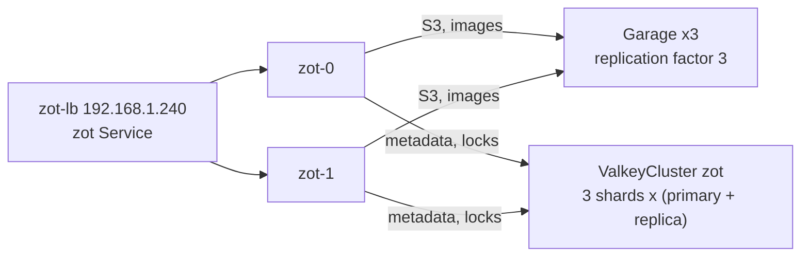

# zot registry

zot is the pull-through cache and CI registry of the cluster (`docs/registry-mirrors.md`). It runs as 2 replicas, one per node,
so draining a node leaves one replica serving. The replicas do not own data: the images are in Garage and the metadata is in
Valkey, both shared.

| Part | Where |
|---|---|
| zot (HelmRelease, config `zot.json`, Services) | here |
| Garage, the object store (3 nodes, layout Job, PodDisruptionBudget) | `../garage/` |
| `ValkeyCluster/zot` | `../valkey/valkeycluster.yaml` |
| The Valkey operator | `k8s/infra/controllers/valkey-operator-system/` (must watch `registry-system`) |
| Secrets `garage-secrets`, `garage-s3-key` | External Secrets from `secret-store` (`zot-garage-*`) |
| Network policies | `../networkpolicy.yaml` |

## How it works

- **Not zot's scale-out `cluster` mode.** There each repository is owned by one replica and a replica that is down takes its
  repositories with it. Here both replicas serve every repository. The price: two replicas can write the same repository at
  once, which for a cache means at worst a tag that is fetched or pushed again.
- **Garage** stores every object on all 3 nodes (`replicationFactor 3`), so a read and a write need 2 of 3. `garage-layout`
  (`../garage/layout-job.yaml`) assigns the nodes, creates the `zot` bucket and imports the S3 key; delete the Job to run it again.
- **Valkey** is a cluster of 3 shards. zot's keys all start with the hash tag `{zot}` (`keyprefix` in `zot.json`), because zot
  changes several keys in one transaction and a cluster only allows that inside one slot. So one shard holds all the data and
  the other two only vote in a failover. Do not remove the braces.
- **`downloadDir`**: with S3 storage the sync extension needs a local staging directory. It is on the zot volume
  (`/var/lib/registry/sync`, 30Gi), where an image is downloaded whole before it is pushed to Garage.
- **Sync, retention and GC** are unchanged from a single-node zot (`zot.json`). They now run on both replicas.

## Draining a node

The PodDisruptionBudgets of zot, Garage and Valkey each allow one pod down at a time, so drain one node at a time and wait for
the pods to come back before the next. Tested on a 4-node kind cluster under continuous pulls:

- A drain of the node with the Valkey primary of zot's slot gave about 8 seconds and 2 failed requests. zot's Redis client only
  re-reads the slot map every 60 s or on a `MOVED` reply, so the Valkey server container has a `preStop` hook: a primary hands over
  to its replica and stays up 15 s as a replica, which answers `MOVED`. Without the hook the failures lasted about 50 s.
- Draining any other node was invisible to clients.

After a drain, `kubectl -n registry-system get valkeycluster zot` shows `Ready` again once the pods are rescheduled, and
`kubectl -n registry-system exec garage-0 -- /garage status` should show the 3 nodes with an empty `ResyncQueue`.

## Changing it

- **zot volume size**: `volumeClaimTemplates` are immutable, so changing `pvc.storage` makes the Helm upgrade fail
  (`docs/helmrelease-conventions.md`). Delete the StatefulSet without its pods and the claims, then let Flux recreate them:
  `kubectl -n registry-system delete sts zot --cascade=orphan` and `kubectl -n registry-system delete pvc -l app.kubernetes.io/name=zot`.
  Nothing is lost: the images are in Garage.
- **Garage size**: keep the data PVC size in `garage/helm-release.yaml` equal to `CAPACITY` in `garage/configure.sh`, and within the
  free `lvm-fast` space of the smallest node.
- **More replicas**: raise `replicaCount`; nothing else lists the replicas. Keep `topologySpreadConstraints` and the PodDisruptionBudget in mind.
- **Rendered manifests**: after editing `helm-release.yaml` run `make render-manifests RENDER_DIRS=./k8s/infra/registry-system/zot`.
- **Local test**: a kind cluster with 3 workers, the Valkey operator chart, `valkeycluster.yaml`, and the rendered Garage and zot
  manifests reproduces all of this. Alias `lvm-fast` to kind's `standard` StorageClass.
