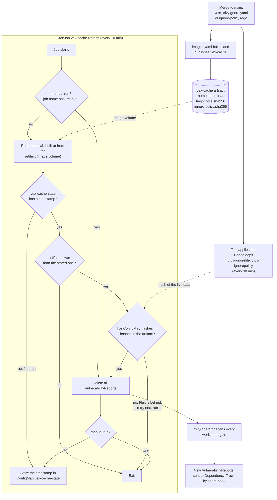

# vex-cache-refresh

Rescans every workload when a new `vex-cache` artifact is published, so the reports follow a changed VEX document,
ignore file or ignore policy. The CronJob runs every 10 minutes in `trivy-system` (`cronjob.yaml`, script in `refresh.sh`).

## Flow

## Why the guard

CI and Flux are independent: the artifact can be published minutes before Flux applies the new ignore ConfigMaps, which the scan
jobs read. Deleting then would rescan with the old rules and record the new timestamp as handled, so the change would never apply.
The artifact therefore carries the sha256 of the ignore file and policy it was built from, and the job deletes only when the live
ConfigMaps hash to the same values. Otherwise it exits and checks again on the next run. A change to `vex/` only passes at once.

## State and permissions

- `vex-cache-state` (`configmap-state.yaml`): `data.built-at` is written by the job. The annotation `kustomize.toolkit.fluxcd.io/ssa: IfNotPresent` makes Flux create it once and never apply it again: without it each Flux reconcile removed `data.built-at`, so the job recorded "first run" and never rescanned.
- Run it now: the Run jobs page in the cockpit lists it (namespace label `claude-jobs/run`, annotation `claude-jobs/description` in `cronjob.yaml`); a manual run skips the checks and always deletes all reports.
- `rbac.yaml`: list and delete `vulnerabilityreports` cluster-wide; get and patch only the three ConfigMaps above in `trivy-system`.
- The first run records the timestamp and deletes nothing.
- A run started from the Run jobs page always deletes all reports, without the artifact or the guard, and leaves the stored timestamp alone (the next scheduled run may rescan once more).

## Check it

- `kubectl -n trivy-system get cronjob,jobs`, then `kubectl -n trivy-system logs job/<name>` says why the last run deleted or waited.
- `kubectl -n trivy-system get configmap vex-cache-state -o jsonpath='{.data.built-at}'` is the last artifact handled.
- A new artifact by hand: run the `Images` workflow (`workflow_dispatch`); a rebuild also follows a change to `vex/`, `trivyignore.yaml` or `ignore-policy.rego` on `main`.
